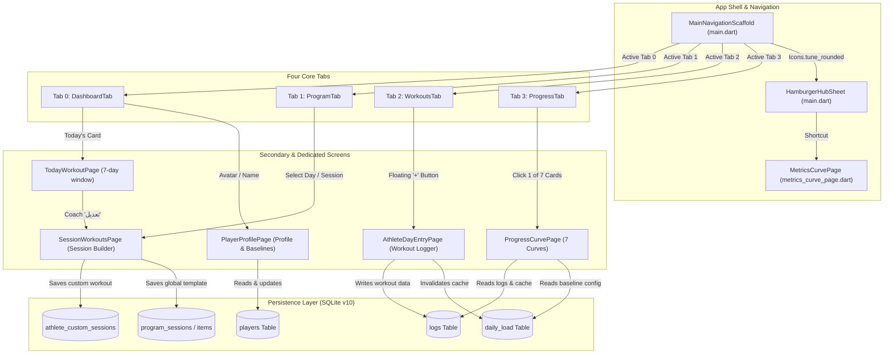
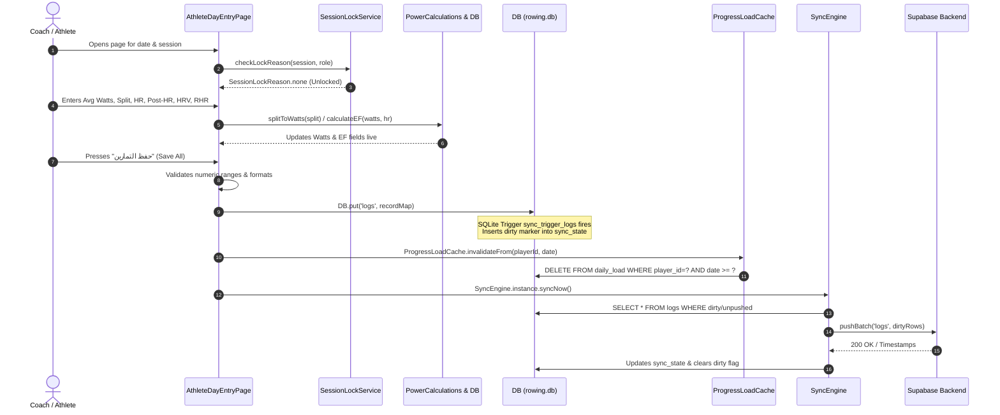
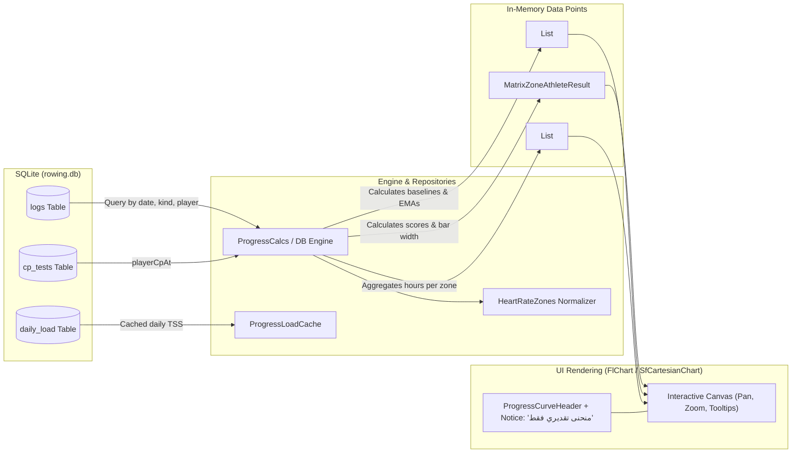
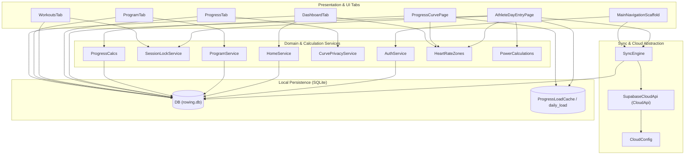
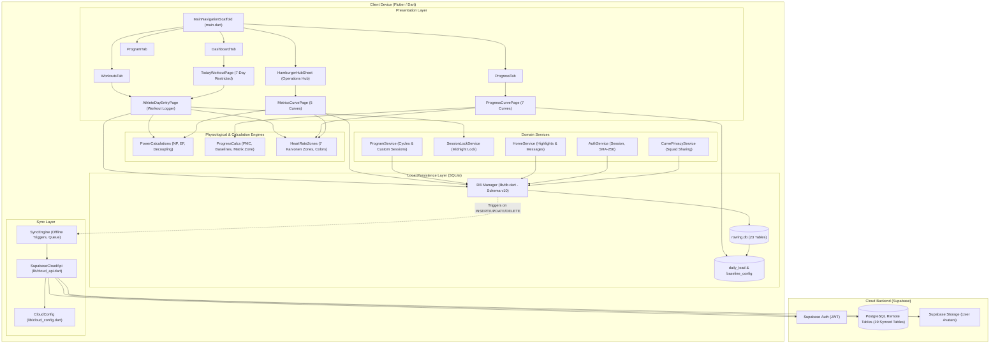
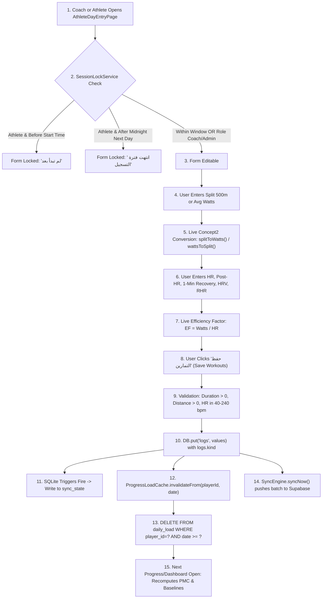
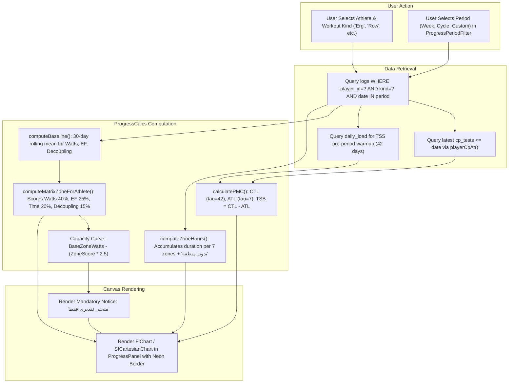
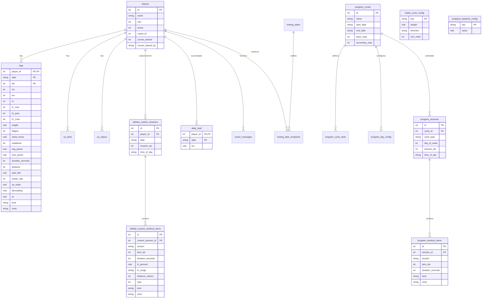

# ENGINE ROWING — FULL REVERSE ENGINEERING, UI & IMPLEMENTATION AUDIT

> **Audit Type:** Exhaustive Read-Only Architectural & Physiological Audit  
> **Target Application:** ENGINE ROWING (Flutter / Dart / SQLite / Supabase)  
> **Database:** `rowing.db` (Schema Version 10)  
> **Audit Date:** November 2026  
> **Auditor:** Antigravity Agentic Senior Software Architect & Rowing Physiologist  
> **Integrity Mode:** STRICTLY READ-ONLY (No source code, database records, dependencies, or configuration altered)

---

## EXECUTIVE SUMMARY

This audit provides a comprehensive, granular reverse-engineering baseline of the **ENGINE ROWING** mobile application. The primary objective is to prepare the technical foundation for integrating the upcoming **HR Zone Calibration & Physiological Sensor Engine** (incorporating Stroke Rate mappings, sub-zone physiological markers like LISS, LT1, VT1, MLSS, LT2, VT2, and live sensor acquisition) without breaking, regressing, or modifying any existing calculation, database structure, UI component, or business rule.

### Critical Top-Level Audit Discoveries

1. **Backend Discrepancy (Supabase vs. Xano):**  
   While original planning references questioned a Xano backend (Part 10), the application **exclusively uses Supabase** (`supabase_flutter: ^2.18.3`, `lib/cloud_api.dart`, `lib/cloud_config.dart`) paired with a robust local-first SQLite offline synchronization engine (`lib/sync_engine.dart`). **Xano is entirely absent from the codebase.**
2. **Current Physiological Model:**  
   The application implements a 7-zone Karvonen model (`Z1` to `VO2 max`) based on $HRR = MHR - RHR$, where $RHR$ is dynamically computed from the 7-day rolling average of resting logs. It strictly forbids the term "Lactate" in the UI (replacing it with "منحنى القدرة" / Capacity Curve), and displays a mandatory notice: `"منحنى تقديري فقط"` ("Estimated curve only").
3. **Database Version & Structure:**  
   The SQLite database is at version 10 (`rowing.db`). It features 23 operational, config, and sync tables (including `logs`, `players`, `program_cycles`, `athlete_custom_sessions`, `athlete_custom_workout_items`, `matrix_zone_config`, and `progress_baseline_config`).
4. **Active Workspace Separation:**  
   The active production code resides exclusively inside `lib/` (41 Dart files) and is verified by 194 automated tests across 20 test suites in `test/`. The repository root contains 10 legacy/loose duplicate files (`app_strings.dart`, `db.dart`, etc.) which are disconnected and must remain untouched.

---

# PART 1 — COMPLETE PROJECT STRUCTURE

## 1.1 Complete Folder and File Structure

```
e:\program\engine_rowing\
├── .dart_tool/                  # Dart build cache & package config
├── android/                     # Android native project & Gradle wrapper
├── assets/                      # Application assets
│   └── images/                  # Static logos, avatars, icons
├── build/                       # Flutter compiled artifacts
├── ios/                         # iOS native project
├── lib/                         # ACTIVE APPLICATION SOURCE CODE (41 files)
│   ├── admin_page.dart          # Coach/Admin management & user subscriptions
│   ├── admin_placeholder.dart   # Placeholder for future admin extensions
│   ├── app_strings.dart         # Arabic/English localization strings (1,920+ lines)
│   ├── athlete_custom_session.dart # Models for athlete custom session overrides
│   ├── athlete_day_entry_page.dart # Athlete daily workout entry & physiological logging
│   ├── auth_service.dart        # Authentication, session tokens, SHA-256 + salt
│   ├── cloud_api.dart           # Supabase cloud client & MockCloudApi interface
│   ├── cloud_config.dart        # Cloud configuration & anon key resolver
│   ├── cloud_config.example.dart# Template configuration
│   ├── cloud_config.local.dart  # Active Supabase URL & anon key
│   ├── coach_request_service.dart # Coach-athlete connection requests
│   ├── curve_privacy_service.dart # Teammate curve sharing & privacy access
│   ├── cycle_template_page.dart # Weekly cycle template management
│   ├── cycle_weekly_cycles_page.dart # Cycle calendar & macro/meso cycles
│   ├── dashboard_tab.dart       # Dashboard tab: Readiness, alerts, today's workout
│   ├── day_sessions_page.dart   # Day sessions overview & scheduling
│   ├── db.dart                  # Core SQLite manager (Schema v10, CRUD, math helpers)
│   ├── engine_rowing_ui.dart    # Design tokens, theme, Poppins font, LtrNumericBox
│   ├── heart_rate_zones.dart    # 7 Karvonen zones, normalizer, color tokens
│   ├── home_service.dart        # Dashboard highlights & coach-to-athlete notifications
│   ├── login_page.dart          # Auth screen (Login, Register, Role selector)
│   ├── main.dart                # App entry point, MainNavigationScaffold, HamburgerHubSheet
│   ├── metrics_curve_page.dart  # 5-tab advanced training metrics curves
│   ├── player_entry_page.dart   # Add/Edit athlete profile & physiological targets
│   ├── player_profile.dart      # Comprehensive athlete physiological profile
│   ├── power_calculations.dart  # Coggan Normalized Power, EF, Decoupling math
│   ├── program_cycle.dart       # Program cycle models & definitions
│   ├── program_service.dart     # Macro/meso cycle database engine & workout items
│   ├── program_tab.dart         # Program tab: Calendar, cycles, session details
│   ├── progress_baseline_config.dart # Progress baseline persistence
│   ├── progress_calcs.dart      # PMC (CTL/ATL/TSB), Moving Avg, Matrix Zone engine
│   ├── progress_curve_header.dart # Common curve header & export button
│   ├── progress_curve_page.dart # 7-curve deep analytics page
│   ├── progress_panel.dart      # Phosphor-bordered glowing container widget
│   ├── progress_period_filter.dart # Tri-mode filter (Week, Cycle, Custom Range)
│   ├── progress_tab.dart        # Progress tab entry grid (7 analytics curve cards)
│   ├── session_lock_service.dart# Session locking rules (Midnight lock & Not-started)
│   ├── session_workouts_page.dart # Coach session workout builder (Warmup, Main, Cooldown)
│   ├── settings_tab.dart        # Settings & cloud sync controls
│   ├── sync_engine.dart         # Local-first 19-table bidirectional sync engine
│   ├── sync_status_widget.dart  # AppBar animated sync indicator
│   ├── today_workout_page.dart  # 7-day restricted today's workout viewer
│   ├── user_avatar_widget.dart  # Avatar image picker & cloud uploader
│   └── workouts_tab.dart        # Workouts tab: History list & calendar filter
├── test/                        # TEST SUITE (194 tests across 20 files)
│   ├── cloud_auth_test.dart
│   ├── container_audit_test.dart
│   ├── db_v5_upgrade_test.dart
│   ├── db_v10_upgrade_test.dart
│   ├── layout_overflow_test.dart
│   ├── login_test.dart
│   ├── matrix_zone_test.dart
│   ├── metrics_curve_test.dart
│   ├── phase1_test.dart
│   ├── phase_c2_cleanup_test.dart
│   ├── phase_s3_test.dart
│   ├── program_tab_test.dart
│   ├── progress_calcs_test.dart
│   ├── progress_responsive_test.dart
│   ├── progress_tab_test.dart
│   ├── responsive_overflow_test.dart
│   ├── session_lock_test.dart
│   ├── sync_engine_test.dart
│   ├── widget_test.dart
│   └── workouts_tab_athlete_role_test.dart
├── pubspec.yaml                 # Dependencies & asset declarations
└── [Root Legacy Files]          # 10 loose duplicate files in root (DISCONNECTED)
```

## 1.2 Application Entry Points & Lifecycle

- **Entry Point:** `lib/main.dart` -> `void main() async`.
- **Initialization Sequence:**
  1. `WidgetsFlutterBinding.ensureInitialized()`
  2. Setup FFI for desktop/testing if applicable (`sqfliteFfiInit()`)
  3. Initialize SQLite DB (`await DB.db`) -> triggers schema creation/migration up to v10.
  4. Initialize `AuthService` -> checks `SharedPreferences` for cached login tokens (`auth_session_user_id`).
  5. Initialize `CloudApi` via `SupabaseCloudApi` if `CloudConfig.isConfigured` is true.
  6. Initialize `SyncEngine.instance.ensureDatabaseSyncSchema(db)`.
  7. Run `runApp(const IronmanApp())`.

## 1.3 Main Architectural Layers

| Layer | Files | Responsibilities |
|---|---|---|
| **Presentation / UI** | `main.dart`, `dashboard_tab.dart`, `program_tab.dart`, `workouts_tab.dart`, `progress_tab.dart`, `progress_curve_page.dart`, `metrics_curve_page.dart`, `today_workout_page.dart`, `athlete_day_entry_page.dart`, `session_workouts_page.dart`, `login_page.dart`, `admin_page.dart` | Rendering dark theme UI (`EngineRowingUI`), handling user interactions, managing local `StatefulWidget` states, input validation, responsiveness via `RowingResponsive`. |
| **Design Tokens & Formatting** | `engine_rowing_ui.dart`, `progress_panel.dart`, `progress_curve_header.dart` | Global theme (`ThemeData.dark`), color palette (`bgNavy`, `neonLime`, `cardFill`), `RowingNumberFormatter` (converting Hindi to Arabic/English digits), `LtrNumericBox` (enforcing LTR on numerical spans). |
| **Calculation & Physiological Engines** | `power_calculations.dart`, `progress_calcs.dart`, `heart_rate_zones.dart` | Coggan Normalized Power ($NP$), Efficiency Factor ($EF$), Decoupling ($Pw:HR$), Critical Power ($CP$ & $W'$), Karvonen zones, Performance Management Chart ($CTL, ATL, TSB$), Matrix Zone scores, moving averages. |
| **Domain Services & Logic** | `auth_service.dart`, `session_lock_service.dart`, `home_service.dart`, `program_service.dart`, `curve_privacy_service.dart`, `coach_request_service.dart` | Session access gates, athlete/coach permissions, coach message distribution, athlete workout customization logic, teammate privacy filters. |
| **Local Persistence (SQLite)** | `db.dart` | SQLite singleton (`rowing.db`, v10), 23 tables, raw SQL execution, upgrade migrations, baseline queries, daily load caching (`daily_load`). |
| **Cloud Synchronization** | `cloud_api.dart`, `cloud_config.dart`, `sync_engine.dart` | Supabase HTTP/WebSocket integration, change detection via SQLite triggers, pull/push batches, conflict resolution (timestamp-based), offline queues. |

## 1.4 Disconnected & Root Duplicate Files Register

The project root directory contains 10 `.dart` files that are relics of previous iterations before code was consolidated into `lib/`:
1. `app_strings.dart` (root)
2. `dashboard_tab.dart` (root)
3. `db.dart` (root)
4. `heart_rate_zones.dart` (root)
5. `main.dart` (root)
6. `player_entry_page.dart` (root)
7. `player_profile.dart` (root)
8. `power_calculations.dart` (root)
9. `settings_tab.dart` (root)
10. `workouts_tab.dart` (root)

> [!WARNING]
> **Strict Isolation Requirement:** Dart build tools and Flutter test runners compile **only** `lib/*.dart`. The root files are completely disconnected. They must NOT be imported, edited, or referenced by any future physiological engine files.

---

# PART 2 — SCREEN-BY-SCREEN REVERSE ENGINEERING

## 2.1 Screen 1: Main Navigation Shell & App Bar (`MainNavigationScaffold`)

### A. Screen Identity
- **Screen Name:** Main Navigation Scaffold (الهيكل الرئيسي للتطبيق)
- **File Path:** [main.dart](file:///e:/program/engine_rowing/lib/main.dart#L125-L600)
- **Widget / Class Name:** `MainNavigationScaffold` (`StatefulWidget`)
- **Invocation:** Loaded directly after authentication in `IronmanApp`.
- **Navigation Mechanism:** Bottom Navigation Bar + Persistent Header / Collapsible Side Drawer. Manages `_currentIndex` (0 to 3). Passes `user` state to child tabs.

### B. Complete UI Inventory
| Element | Input/Output | Data Type | Default Value | Validation | State Source | Action |
|---|---|---|---|---|---|---|
| Hamburger Menu Button (`Icons.menu_rounded`) | Interactive | Event | N/A | Always active | Local UI State | Toggles lateral side navigation bar (`_toggleSideNav()`). |
| Operations Hub Button (`Icons.tune_rounded`) | Interactive | Event | N/A | Always active | Local UI State | Opens `HamburgerHubSheet` modal bottom sheet. |
| Tab Title Text | Output | String | "الرئيسية" | Validated by index | `AppStrings.of(context)` | Displays localized title of active tab. |
| Real-time Sync Status Icon | Output / Interactive | Status Enum | Idle | Connectivity check | `SyncEngine.instance` | Shows synced (cloud check), syncing (spinning), or dirty count badge. On tap: triggers `syncNow()`. |
| User Avatar Circle | Output / Interactive | String / Path | Local avatar / Initials | Validated user session | `AuthService.currentUser` | Opens `PlayerProfilePage` or user settings modal. |
| Bottom Nav Tab 0: Home | Interactive | Index | 0 (Active) | Valid role | `_currentIndex == 0` | Switches view to `DashboardTab`. |
| Bottom Nav Tab 1: Program | Interactive | Index | 1 | Coach / Athlete role | `_currentIndex == 1` | Switches view to `ProgramTab`. |
| Bottom Nav Tab 2: Workouts | Interactive | Index | 2 | Valid role | `_currentIndex == 2` | Switches view to `WorkoutsTab`. |
| Bottom Nav Tab 3: Progress | Interactive | Index | 3 | Valid role | `_currentIndex == 3` | Switches view to `ProgressTab`. |

### C. Screen Operations & Execution Path
1. **Tab Switch:** User taps bottom navigation item $\rightarrow$ `setState(() => _currentIndex = index)` $\rightarrow$ builds indexed tab.
2. **Side Nav Toggle:** `_toggleSideNav()` animates `_navWidth` between `0.0` and `280.0` with standard dark scrim overlay.
3. **Sync Engine Binding:** Listens to `SyncEngine.instance` via `AnimatedBuilder`. When database dirty count changes, updates visual pill color and badge count.

---

## 2.2 Screen 2: Dashboard Tab (`DashboardTab`)

### A. Screen Identity
- **Screen Name:** Dashboard Tab (لوحة المتابعة والجاهزية)
- **File Path:** [dashboard_tab.dart](file:///e:/program/engine_rowing/lib/dashboard_tab.dart#L13-L200)
- **Widget / Class Name:** `DashboardTab` (`StatefulWidget`)
- **Invocation:** Embedded as Tab 0 in `MainNavigationScaffold`.

### B. Complete UI Inventory
| Element | Input/Output | Data Type | Default Value | Validation | State Source | Action |
|---|---|---|---|---|---|---|
| Athlete Dropdown Selector (Coach only) | Input | Integer (`playerId`) | First active athlete | `id > 0` | `DB.players()` | Filters dashboard metrics to selected athlete. |
| Physiological Readiness Gauge | Output | Double (0 - 100) | 70.0 | Clamped 0-100 | `DB.calculateReadiness()` | Visual radial/bar meter with color coding (Green $\ge 80$, Yellow $\ge 60$, Orange $\ge 40$, Red $< 40$). |
| Readiness Status Text | Output | String | "جيد" | Derived from score | `readinessText(score)` | Displays physiological condition label. |
| TSB Balance Card | Output | Double ($TSB$) | 0.0 | Calculated | `DB.playerTSB(playerId)` | Displays Training Stress Balance ($TSB = CTL - ATL$) with status badge. |
| 7-Day Zone Distribution Chart | Output | Map<String, int> | Empty map | 7 zones | `DB.playerZoneDistribution()` | Displays horizontal stacked bar of seconds spent in each zone over past 7 days. |
| Overtraining / Health Alerts Card | Output | List<String> | Empty list | Threshold triggers | `DB.overtrainingAlerts()` | Warning banners (e.g. HRV drop $> 20\%$, RHR elevation $> 5\text{ bpm}$, TSB $< -25$). |
| Today's Workout Card | Output / Interactive | Workout Slot | Empty slot | Active cycle | `ProgramService.getTodayWorkouts()` | Summary of scheduled session. Tap navigates to `TodayWorkoutPage`. |
| Upcoming Testing Dates Banner | Output | List | Empty list | Active tests | `HomeService.getUpcomingTestingDates()` | Displays upcoming CP/Erg test dates with countdown. |
| Coach Unread Message Banner | Output / Interactive | Object | Null | Unread state | `HomeService.getUnreadCoachMessage()` | Shows banner if coach posted a note. Tap marks as read. |

### C. Screen Operations & Execution Path
- **Data Loading:** `_loadDashboardData()` runs concurrent SQLite queries:
  - `DB.latestLog(playerId)`: Retrieves previous day's HRV, RHR, fatigue, sleep.
  - `DB.playerBaseline(playerId)`: Computes rolling 30-day baseline for RHR and HRV.
  - `DB.playerTSB(playerId)`: Fetches current Chronic vs Acute Training Load balance.
  - `calculateReadiness()`: Combines TSB, HRV ratio, RHR deviation, fatigue, and sleep hours into a composite 0-100 score.

---

## 2.3 Screen 3: Program & Cycle Management Tab (`ProgramTab`)

### A. Screen Identity
- **Screen Name:** Training Program Tab (إدارة البرامج والسايكلات)
- **File Path:** [program_tab.dart](file:///e:/program/engine_rowing/lib/program_tab.dart#L26-L350)
- **Widget / Class Name:** `ProgramTab` (`StatefulWidget`)
- **Invocation:** Tab 1 of `MainNavigationScaffold`.

### B. Complete UI Inventory
| Element | Input/Output | Data Type | Default Value | Validation | State Source | Action |
|---|---|---|---|---|---|---|
| Cycle Selector Dropdown | Input | Integer (`cycleId`) | Active cycle | Valid `cycleId` | `ProgramService.getAllProgramCycles()` | Switches displayed macro/meso cycle. |
| Add Cycle Button (`+`) (Coach only) | Interactive | Event | N/A | Role == Coach | N/A | Opens dialog to create new cycle with date range and rep targets. |
| Cycle Dates Range Label | Output | String | "YYYY-MM-DD to YYYY-MM-DD" | Formatted dates | `ProgramCycle.start_date` / `end_date` | Displays cycle boundaries. |
| 7-Day Zone Total Summary Card | Output | Map<String, int> | 0s | 7 zones | `calculateCycleTotalZoneSeconds()` | Displays total programmed hours/minutes per zone. |
| Weekly Calendar Strip | Interactive | DateTime | Current date | Within cycle | Local UI State | Selects day to view sessions. |
| Day Sessions List | Output / Interactive | List | Daily sessions | Valid session | `ProgramService.getDaySessionsDetailed()` | Displays cards for each session of selected day. Tap opens `SessionWorkoutsPage`. |
| Copy / Apply Template Button (Coach only) | Interactive | Event | N/A | Template exists | `cycle_templates` | Applies recurring weekly template to target dates. |

---

## 2.4 Screen 4: Workouts Tab & History (`WorkoutsTab`)

### A. Screen Identity
- **Screen Name:** Workouts Tab (سجل التمارين المنفذة)
- **File Path:** [workouts_tab.dart](file:///e:/program/engine_rowing/lib/workouts_tab.dart#L20-L250)
- **Widget / Class Name:** `WorkoutsTab` (`StatefulWidget`)
- **Invocation:** Tab 2 of `MainNavigationScaffold`.

### B. Complete UI Inventory
| Element | Input/Output | Data Type | Default Value | Validation | State Source | Action |
|---|---|---|---|---|---|---|
| Athlete Dropdown Filter (Coach only) | Input | Integer | All athletes (null) | Valid `playerId` | `DB.players()` | Filters logs to chosen athlete. |
| Date Range Filter Chips | Input | Enum | Last 30 Days | Valid enum | Local UI State | Filters by 7 days, 30 days, 90 days, or All time. |
| Workout Kind Filter Chips | Input | String | "All" | Valid kind | `logs.kind` | Filters by Erg, Row, Bike, Run, Gym. |
| Workout Log Card List | Output / Interactive | List of Map | Empty list | Valid records | `DB.q('SELECT * FROM logs ...')` | Displays past workouts: Date, Distance, Duration, Avg Watts, Split, Zone chip. Tap opens details or `AthleteDayEntryPage`. |
| Log Entry Floating Action Button (`+`) | Interactive | Event | N/A | Session lock check | Local UI State | Opens `AthleteDayEntryPage` for today's session. |

---

## 2.5 Screen 5: Progress Analytics Hub (`ProgressTab`)

### A. Screen Identity
- **Screen Name:** Progress Tab (تبويب التقدم والتحليلات البيانية)
- **File Path:** [progress_tab.dart](file:///e:/program/engine_rowing/lib/progress_tab.dart#L29-L150)
- **Widget / Class Name:** `ProgressTab` (`StatefulWidget`)
- **Invocation:** Tab 3 of `MainNavigationScaffold`.
- **Role Isolation:** If logged in as an athlete, strictly locked to `currentUser.playerId`. Coach can view all athletes or switch players.

### B. Complete UI Inventory (7 Analytics Cards Grid)
| Element | Input/Output | Data Type | Default Value | Validation | State Source | Action |
|---|---|---|---|---|---|---|
| 1. Matrix Zone Card | Interactive | Event | N/A | Always active | N/A | Navigates to `ProgressCurvePage(type: ProgressCurveType.matrixZone)`. |
| 2. EF & Decoupling Card | Interactive | Event | N/A | Always active | N/A | Navigates to `ProgressCurvePage(type: ProgressCurveType.efAndDecoupling)`. |
| 3. Capacity Curve Card ("منحنى القدرة") | Interactive | Event | N/A | Strictly not named Lactate | N/A | Navigates to `ProgressCurvePage(type: ProgressCurveType.watts)`. |
| 4. PMC Load Card (CTL/ATL/TSB) | Interactive | Event | N/A | Always active | N/A | Navigates to `ProgressCurvePage(type: ProgressCurveType.pmcLoad)`. |
| 5. Recovery Curves Card (HRV/RHR/Sleep) | Interactive | Event | N/A | Always active | N/A | Navigates to `ProgressCurvePage(type: ProgressCurveType.recovery)`. |
| 6. Zone Hours Card (7 zones + No Zone) | Interactive | Event | N/A | Always active | N/A | Navigates to `ProgressCurvePage(type: ProgressCurveType.zoneHours)`. |
| 7. CP Tests Card (CP & W') | Interactive | Event | N/A | Always active | N/A | Navigates to `ProgressCurvePage(type: ProgressCurveType.cpTests)`. |
| Teammates Curve Sharing Toggle | Input / Interactive | Boolean | False | Coach approval | `players.curves_shared` | Toggles sharing athlete's curve data with squad members via `CurvePrivacyService`. |

---

## 2.6 Screen 6: Deep Analytics & Curve Engine (`ProgressCurvePage`)

### A. Screen Identity
- **Screen Name:** Progress Curve Page (شاشة المنحنيات التفصيلية السبعة)
- **File Path:** [progress_curve_page.dart](file:///e:/program/engine_rowing/lib/progress_curve_page.dart#L103-L700)
- **Widget / Class Name:** `ProgressCurvePage` (`StatefulWidget`)
- **Invocation:** Pushed via `Navigator.push` from `ProgressTab`. Receives `initialType` (`ProgressCurveType`).

### B. Complete UI Inventory
| Element | Input/Output | Data Type | Default Value | Validation | State Source | Action |
|---|---|---|---|---|---|---|
| Athlete Horizontal Selector Strip | Input / Interactive | Integer | Active athlete | `playerId > 0` | `DB.players()` | Selects which athlete's curves are rendered. |
| Progress Period Filter Bar (`ProgressPeriodFilter`) | Input / Interactive | Object | Default Week (7 days) | Valid date range | `ProgressPeriodSelection` | Switches between Week, Cycle (from `program_cycles`), or Custom Date Range. |
| Workout Kind Dropdown Filter | Input | String | "All" | Valid kind | `logs.kind` | Isolates workouts by kind (Ergometer, On-Water, etc.) ensuring no cross-contamination. |
| FlChart / SfCartesianChart Surface | Output / Interactive | Chart Data | Curve points | Non-empty points | `ProgressCalcs` engine | Interactive canvas with touch tooltips, dashed trendlines, and baseline reference lines. |
| 7-Day Moving Average Toggle | Input / Interactive | Boolean | True | Boolean | Local UI State | Toggles smoothed moving average curve overlay. |
| Matrix Zone Info Button (`(i)`) | Interactive | Event | N/A | Always active | Local UI State | Opens explanatory modal describing indicators (Watts 40%, EF 25%, Time 20%, Decoupling 15%). |
| Mandatory Curve Notice Label | Output | String | "منحنى تقديري فقط" | Static Arabic text | Immutable | Displayed permanently below charts to ensure physiological clarity. |
| Export Data Button | Interactive | Event | N/A | Data available | Local UI State | Exports displayed curve points to structured CSV/Excel format. |

---

## 2.7 Screen 7: Advanced Metrics Curves Page (`MetricsCurvePage`)

### A. Screen Identity
- **Screen Name:** Training Metrics Curves (شاشة منحنيات مؤشرات التدريب)
- **File Path:** [metrics_curve_page.dart](file:///e:/program/engine_rowing/lib/metrics_curve_page.dart#L67-L200)
- **Widget / Class Name:** `MetricsCurvePage` (`StatefulWidget`)
- **Invocation:** Opened from `HamburgerHubSheet` $\rightarrow$ "فتح لوحة المنحنيات الكاملة".
- **Structure:** 5 sub-tabs: 1. EF Curve, 2. Watts Curve, 3. Decoupling Curve, 4. Heart Rate Curve, 5. Zone Curve (Default initial tab).

### B. Complete UI Inventory
| Element | Input/Output | Data Type | Default Value | Validation | State Source | Action |
|---|---|---|---|---|---|---|
| Tab Bar (5 Tabs) | Interactive | Index | 4 (Zone Curve) | 0 to 4 | `_tabController` | Switches between the 5 training metric curves. |
| Player Dropdown | Input | Integer | Team Average (null) | Valid `playerId` | `DB.players()` | Selects athlete or team-wide aggregate. |
| Period Selector Chips | Input | Enum | 30 Days | `MetricsPeriod` | Local UI State | 7 Days, 30 Days, 90 Days, All Time, Custom. |
| 7-Zone Checkbox Filter (Tab 5) | Input | Set<String> | All 7 selected | 1 to 7 zones | `HeartRateZones.orderedZones` | Toggles visibility of specific zones in Zone Curve. |
| Excel Export Button | Interactive | Event | N/A | Records exist | Local UI State | Exports multi-zone daily watt averages to spreadsheet. |

---

## 2.8 Screen 8: Athlete Daily Workout & Physiological Entry (`AthleteDayEntryPage`)

### A. Screen Identity
- **Screen Name:** Athlete Day Entry Page (تسجيل تمرين وبيانات اليوم)
- **File Path:** [athlete_day_entry_page.dart](file:///e:/program/engine_rowing/lib/athlete_day_entry_page.dart#L80-L500)
- **Widget / Class Name:** `AthleteDayEntryPage` (`StatefulWidget`)
- **Invocation:** Opened from `WorkoutsTab` (`+` FAB) or `TodayWorkoutPage`.
- **Access Gate:** Checks `SessionLockService.isSessionLocked()`. If locked, inputs are disabled and save button is greyed out.

### B. Complete UI Inventory
| Element | Input/Output | Data Type | Default Value | Validation | State Source | Action |
|---|---|---|---|---|---|---|
| Workout Kind Dropdown | Input | String | "Erg" | Non-empty | Local UI State | Saves chosen kind to `logs.kind` for this athlete. |
| Training Zone Dropdown | Input | String | "Z2" | 7 zones | `HeartRateZones.orderedZones` | Identifies physiological zone for the workout item. |
| Average Power (`avgPowerCtrl`) | Input | Double (Watts) | Empty | $> 0$, Numeric | Local Controller | Workout average power in Watts. |
| Split 500m (`splitCtrl`) | Input / Output | String ("M:SS.S") | Empty | Regex `\d+:\d{2}\.?\d?` | Local Controller | Auto-calculates Watts via `splitToWatts()`. |
| Distance (`distanceCtrl`) | Input | Integer (Meters) | Empty | $> 0$ | Local Controller | Distance completed in meters. |
| Heart Rate During (`hrCtrl`) | Input | Integer (BPM) | Empty | $40 - 240\text{ bpm}$ | Local Controller | Mean workout heart rate. |
| Post HR (`postHRCtrl`) | Input | Integer (BPM) | Empty | $40 - 240\text{ bpm}$ | Local Controller | Heart rate immediately upon cessation of exercise. |
| 1-Min Recovery HR (`recovery1minCtrl`) | Input | Integer (BPM) | Empty | $40 - 240\text{ bpm}$ | Local Controller | Heart rate exactly 60 seconds post-workout. |
| Normalized Power (`npWattsCtrl`) | Input / Output | Double (Watts) | Empty | $> 0$ | Local Controller | Coggan NP (auto-calculated if split series entered). |
| Decoupling HR (`decouplingHRCtrl`) | Input | Integer (BPM) | Empty | $40 - 240\text{ bpm}$ | Local Controller | Heart rate drift parameter. |
| Decoupling % (`decouplingCtrl`) | Input / Output | Double (%) | Empty | Numeric | Local Controller | Aerobic decoupling percentage ($Pw:HR$). |
| Eupnea Recovery 1, 2, 3 (`eupnea1..3Ctrl`) | Input | Double (Seconds) | Empty | $\ge 0$ | Local Controller | Time to return to normal resting breathing rhythm. |
| Morning HRV (`_hrvCtrl`) | Input | Integer (ms) | Empty | $10 - 250\text{ ms}$ | Local Controller | Morning heart rate variability (rMSSD). |
| Morning RHR (`_rhrCtrl`) | Input | Integer (BPM) | Empty | $30 - 120\text{ bpm}$ | Local Controller | Morning resting heart rate. |
| Sleep Hours (`_sleepCtrl`) | Input | Double (Hours) | Empty | $0 - 24\text{ hrs}$ | Local Controller | Sleep duration. |
| Body Weight (`_weightCtrl`) | Input | Double (kg) | Empty | $30 - 200\text{ kg}$ | Local Controller | Morning body mass. |
| Perceived Fatigue (`_fatigueCtrl`) | Input | Integer (1 - 5) | 3 | $1 \le x \le 5$ | Local Controller | Subjective fatigue score. |
| Save Button (`_saveAllWorkouts`) | Interactive | Event | N/A | All validators pass & not locked | Local UI State | Writes records to `logs`, triggers `ProgressLoadCache.invalidateFrom()`, and triggers `SyncEngine.instance.syncNow()`. |

---

## 2.9 Screen 9: Today's Workout & Coach Customizer (`TodayWorkoutPage`)

### A. Screen Identity
- **Screen Name:** Today's Workout Page (شاشة تمرين اليوم والـ 7 أيام)
- **File Path:** [today_workout_page.dart](file:///e:/program/engine_rowing/lib/today_workout_page.dart#L13-L150)
- **Widget / Class Name:** `TodayWorkoutPage` (`StatefulWidget`)
- **Invocation:** Dashboard quick action or Program navigation.

### B. Complete UI Inventory & Rules
| Element | Input/Output | Data Type | Default Value | Validation | State Source | Action |
|---|---|---|---|---|---|---|
| 7-Day Date Range Selector | Input / Interactive | DateTimeRange | Today $\pm 0$ days | Max 7 days inclusive | Local UI State | Restricts viewing window to a maximum span of 7 days. |
| Athlete List (Coach view) | Output / Interactive | List | Active athletes | Role == Coach | `DB.players()` | Coach selects an athlete to inspect or customize their workouts. |
| Workout Customization Button ("تعديل") | Interactive | Event | N/A | Coach only | Local UI State | Opens `SessionWorkoutsPage` in custom mode for this athlete and date only. |
| Session Workout View Cards | Output | List | Programmed items | Valid items | `ProgramService.getSessionsForAthleteAndDate()` | Displays coach's custom version if present in `athlete_custom_sessions`, otherwise default template. |

> [!IMPORTANT]
> **Strict Isolation Guarantee:** When a coach edits an athlete's workout for a specific day, records are saved **only** to `athlete_custom_sessions` and `athlete_custom_workout_items`. The original cycle template in `program_sessions` and `program_workout_items` is never modified, nor is any other athlete or day affected.

---

## 2.10 Screen 10: Operations Hub Sheet (`HamburgerHubSheet`)

### A. Screen Identity
- **Screen Name:** Operations & Display Hub (لوحة العمليات والتحكم)
- **File Path:** [main.dart](file:///e:/program/engine_rowing/lib/main.dart#L824-L1250)
- **Widget / Class Name:** `HamburgerHubSheet` (`StatelessWidget`)
- **Invocation:** Draggable modal sheet opened via `Icons.tune_rounded` in App Bar.

### B. Complete UI Inventory
| Element | Input/Output | Data Type | Default Value | State Source | Action |
|---|---|---|---|---|---|
| Scale Dropdown Selector | Input | Double | 1.0 (100%) | `userScaleNotifier` | Adjusts UI scale: 80%, 90%, 100%, 110%, 125%, 150%. |
| Color Intensity Selector Chips | Input | Enum | `DisplayIntensity.normal` | `intensityNotifier` | Adjusts phosphor glow & brightness: Normal, Bright, Ultra. |
| Metrics Curves Shortcut Button | Interactive | Event | N/A | UI Callback | Dismisses sheet and opens `MetricsCurvePage`. |
| Export to Excel Card | Output / Interactive | Static UI | "Coming soon" (قريباً) | UI-only placeholder | Disabled button with badge indicating future Phase D release. |

---

## 2.11 Screen-to-Screen Operational & Data Relationships



---

# PART 3 — COMPLETE INPUT, FIELD & DATA EXTRACTION AUDIT

## 3.1 Exhaustive Field & Data Traceability Matrix

The table below catalogs every physiological, biometric, performance, and configuration data field that enters the application:

| Field Name | UI Source Widget | Model / Controller Property | Data Type | Physical Unit | Validation Rules | Default Value | Conversion & Calculations | DB Table & Column | Backend Field (Supabase) | Consumers & Display Screens |
|---|---|---|---|---|---|---|---|---|---|---|
| Athlete Name | `PlayerEntryPage` | `nameCtrl.text` | `String` | Text | Non-empty, max 60 chars | `""` | Trimmed string | `players.name` | `profiles.name` | `DashboardTab`, `ProgramTab`, `ProgressTab`, `TodayWorkoutPage` |
| Max Heart Rate ($MHR$) | `PlayerEntryPage` | `mhrCtrl.text` | `int` | bpm | $100 \le x \le 240$ | `190` | `int.tryParse()` | `players.mhr` | `profiles.mhr` | `HeartRateZones.calculate()`, `ProgressCalcs` |
| Active Status | `PlayerEntryPage` | Toggle Switch | `int` (Boolean) | Flag | 0 or 1 | `1` (Active) | Boolean to 1/0 | `players.active` | `profiles.active` | Athlete lists, queries |
| Curves Shared | `PlayerProfilePage` | Switch | `int` (Boolean) | Flag | 0 or 1 | `0` (Private) | Boolean to 1/0 | `players.curves_shared` | `profiles.curves_shared` | `CurvePrivacyService`, Teammates view |
| Curves Shared By | `PlayerProfilePage` | Role selector | `String` | Role | `'coach'` or `'athlete'` | `'coach'` | Lowercase | `players.curves_shared_by` | `profiles.curves_shared_by` | Permissions filter |
| Workout Date | `AthleteDayEntryPage` | DatePicker / Header | `String` | YYYY-MM-DD | Valid ISO-8601 Date | Today's Date | `dstr(DateTime)` | `logs.date` | `logs.date` | All charts, logs lists, PMC engine |
| Session Index | `AthleteDayEntryPage` | `widget.sessionIdx` | `int` | Counter | $\ge 0$ | `0` | Direct integer | `logs.idx` | `logs.idx` | Distinguishes multiple sessions per day |
| Workout Kind | `AthleteDayEntryPage` | Dropdown | `String` | Category | 'Erg', 'Row', 'Bike', 'Run', 'Gym' | `'Erg'` | Trimmed, case-insensitive | `logs.kind` | `logs.kind` | Progress kind filter, Matrix Zone engine |
| Training Zone | `AthleteDayEntryPage` | Dropdown | `String` | Zone Key | Z1, Z2, Z3, Z4, Threshold, Z5, VO2 max | `'Z2'` | `HeartRateZones.normalizeZoneKey()` | `logs.zone` | `logs.zone` | Zone distribution, Matrix Zone bar |
| Average Power | `AthleteDayEntryPage` | `avgPowerCtrl` | `double` | Watts | $x > 0$, max 1200 | `null` | `double.tryParse()` | `logs.avg_power` | `logs.avg_power` | Watts curve, TSS calc, Matrix Zone |
| Max Power | `PlayerEntryPage` | `maxPowerCtrl` | `double` | Watts | $x \ge avg\_power$ | `null` | `double.tryParse()` | `logs.max_power` | `logs.max_power` | Athlete stats summary |
| 500m Split | `AthleteDayEntryPage` | `splitCtrl` | `double` | Seconds / 500m | Format `M:SS.S` | `null` | `splitToWatts()` / `wattsToSplit()` | `logs.split_500` | `logs.split_500` | Workout cards, Erg charts |
| Distance | `AthleteDayEntryPage` | `distanceCtrl` | `int` | Meters | $x > 0$, max 100,000 | `null` | `int.tryParse()` | `logs.distance` | `logs.distance` | Workout history, mileage accumulator |
| Duration | `AthleteDayEntryPage` | Duration Picker | `int` | Seconds | $x > 0$, max 86,400 | `0` | Minutes $\times 60$ + Seconds | `logs.duration_seconds` | `logs.duration_seconds` | TSS, Zone Hours, Volume charts |
| Heart Rate During | `AthleteDayEntryPage` | `hrCtrl` | `int` | bpm | $40 \le x \le 240$ | `null` | `int.tryParse()` | `logs.hr` | `logs.hr` | EF calc, HR curve, Decoupling |
| Post-Workout HR | `AthleteDayEntryPage` | `postHRCtrl` | `int` | bpm | $40 \le x \le 240$ | `null` | `int.tryParse()` | `logs.hr_post` | `logs.hr_post` | `recoveryRate()` |
| 1-Min Recovery HR | `AthleteDayEntryPage` | `recovery1minCtrl` | `int` | bpm | $40 \le x \le 240$ | `null` | `int.tryParse()` | `logs.hr_1min` | `logs.hr_1min` | Recovery curve |
| Morning Resting HR ($RHR$) | `AthleteDayEntryPage` | `_rhrCtrl` | `int` | bpm | $30 \le x \le 120$ | `null` | `int.tryParse()` | `logs.rhr` | `logs.rhr` | `getEffectiveRHR()`, Karvonen, Readiness |
| Morning $HRV$ | `AthleteDayEntryPage` | `_hrvCtrl` | `int` | ms (rMSSD) | $10 \le x \le 250$ | `null` | `int.tryParse()` | `logs.hrv` | `logs.hrv` | Recovery curve, Readiness score |
| Sleep Hours | `AthleteDayEntryPage` | `_sleepCtrl` | `double` | Hours | $0.0 \le x \le 24.0$ | `null` | `double.tryParse()` | `logs.sleep_hours` | `logs.sleep_hours` | Recovery curve, Readiness score |
| Athlete Body Weight | `AthleteDayEntryPage` | `_weightCtrl` | `double` | kg | $30.0 \le x \le 200.0$ | `null` | `double.tryParse()` | `logs.weight` | `logs.weight` | Weight curve, power-to-weight |
| Perceived Fatigue | `AthleteDayEntryPage` | `_fatigueCtrl` | `int` | 1 to 5 Scale | $1 \le x \le 5$ | `3` | `int.tryParse()` | `logs.fatigue` | `logs.fatigue` | Readiness score, Overtraining alert |
| Normalized Power ($NP$) | `AthleteDayEntryPage` | `npWattsCtrl` | `double` | Watts | $x > 0$ | `null` | Coggan 4th power rolling algorithm | `logs.np_watts` | `logs.np_watts` | Advanced load, IF |
| Aerobic Decoupling ($Pw:HR$) | `AthleteDayEntryPage` | `decouplingCtrl` | `double` | Percentage (%) | $-50.0 \le x \le 100.0$ | `null` | `PowerCalculations.calculateDecoupling()` | `logs.decoupling` | `logs.decoupling` | Decoupling curve, Matrix Zone |
| Decoupling HR | `AthleteDayEntryPage` | `decouplingHRCtrl` | `int` | bpm | $40 \le x \le 240$ | `null` | `int.tryParse()` | `logs.decoupling_hr` | `logs.decoupling_hr` | Aerobic drift audit |
| Efficiency Factor ($EF$) | `AthleteDayEntryPage` | Auto-calculated | `double` | Watts/bpm | $x > 0$ | `null` | $Watts / HR$ | `logs.ef` | `logs.ef` | EF curve, Matrix Zone |
| Eupnea Recovery 1, 2, 3 | `AthleteDayEntryPage` | `eupnea1..3Ctrl` | `double` | Seconds | $x \ge 0$ | `null` | `double.tryParse()` | `logs.eupnea_1..3` | `logs.eupnea_1..3` | Recovery curve |
| Stroke Rate (SPM) | Database column | N/A (Manual/Unused in form) | `int` | spm | $10 \le x \le 60$ | `null` | Stored if supplied | `logs.stroke_rate` / `spm` | `logs.stroke_rate` | **Unused in main input UI (Candidate for future Sensor Engine)** |
| Drag Factor | Database column | N/A | `int` | Damper resistance | $50 \le x \le 250$ | `null` | Concept2 damper factor | `logs.drag_factor` | `logs.drag_factor` | Stored if supplied, no active UI field |
| Energy Joules | Database column | N/A | `int` | Joules | $x \ge 0$ | `null` | Work done | `logs.energy_joules` | `logs.energy_joules` | Stored if supplied, no active UI field |

## 3.2 Critical Observations on Data Inputs

1. **Absence of Real-Time Sensor Streams:**  
   Currently, 100% of workout metrics are entered manually post-workout via `AthleteDayEntryPage`. There is **no live Bluetooth (BLE) connection** to heart rate straps (e.g. Polar H10, Garmin HRM-Pro) or rowing ergs (Concept2 PM5, WaterRower).
2. **Stroke Rate Status:**  
   Columns `logs.stroke_rate` and `logs.spm` exist in the database schema (line 352 of `lib/db.dart`), but they are **omitted from the active text form fields** in `AthleteDayEntryPage`. They represent declared but under-utilized storage ready for the future sensor engine.
3. **Hindi vs. English Numerals:**  
   The application strictly intercepts all numeric inputs using `RowingNumberFormatter.englishDigitsInputFormatter` (in `lib/engine_rowing_ui.dart#L48`), preventing Arabic-Indic digits (`١٢٣`) from corrupting floating-point parses.

---

# PART 4 — COMPLETE WORKOUT EXECUTION AND SAVING TRACE

## 4.1 The 12-Stage Workout Lifecycle

The diagram and narrative below trace the exact operational path of a workout:



### Granular Stage Breakdown

1. **Stage 1: Session Initiation & Selection:**  
   User selects a workout session from `ProgramTab`, `TodayWorkoutPage`, or taps the `+` FAB in `WorkoutsTab`.
2. **Stage 2: Athlete Resolution:**  
   If the user is an athlete, `playerId = currentUser.playerId` (immutable). If a coach, the athlete is selected from the dropdown or passed via navigation argument.
3. **Stage 3: Session Lock Verification:**  
   `SessionLockService.checkLockReason()` evaluates `session.startDateTime` and midnight of next day. If the athlete attempts to log a future session, `SessionLockReason.notStartedYet` blocks editing. If the date is past midnight of the next day, `SessionLockReason.lastSessionExpired` blocks editing. Coaches/admins bypass this check.
4. **Stage 4: Workout Execution:**  
   Physical workout performed on Concept2 Ergometer or on water.
5. **Stage 5: Data Entry:**  
   Athlete enters biometrics (morning HRV/RHR) and workout outputs (Distance, Duration, Watts, Split, Heart Rate).
6. **Stage 6: Intermediate Live Calculations:**  
   - If user edits `splitCtrl` ("1:45.0"), `splitToWatts()` converts it to `302.3 W` and populates `avgPowerCtrl`.
   - If user edits `avgPowerCtrl` ("300 W"), `wattsToSplit()` converts it to `1:45.3` and populates `splitCtrl`.
   - If user provides series of splits or watts, `calculateNormalizedPower()` computes NP.
   - `calculateEF()` updates Efficiency Factor ($EF = Watts / HR$).
7. **Stage 7: Workout Completion:**  
   User completes post-workout checks (Post HR, 1-Min Recovery HR, Eupnea recovery times).
8. **Stage 8: Data Validation:**  
   Form validation verifies non-null duration ($> 0$), positive distance, valid heart rate ranges ($40 - 240\text{ bpm}$), and numeric weights.
9. **Stage 9: Local Database Saving (SQLite):**  
   - Handled by `DB.put('logs', values)` (`lib/db.dart#L966`).
   - Executes an `INSERT OR REPLACE INTO logs` with composite primary key `(player_id, date, idx)`.
   - Saves `logs.kind` for this athlete.
10. **Stage 10: Cache Invalidation:**  
    `ProgressLoadCache.invalidateFrom(playerId, date)` runs:
    `DELETE FROM daily_load WHERE player_id = ? AND date >= ?` (`lib/progress_calcs.dart#L1099`). This forces the PMC engine ($CTL/ATL/TSB$) to re-accumulate historical training stress from the modified date forward.
11. **Stage 11: Backend Synchronization:**  
    `SyncEngine.instance.syncNow()` runs asynchronously. It detects dirty records, packages them into a JSON batch, and pushes them to Supabase via `SupabaseCloudApi.pushBatch()`.
12. **Stage 12: Progress Dashboard Update & Retrieval:**  
    Subsequent visits to `DashboardTab`, `WorkoutsTab`, or `ProgressCurvePage` execute cached or fresh SQL queries, reflecting the updated baseline, TSB, readiness score, and curve points.

---

# PART 5 — COMPLETE MATHEMATICAL AND PHYSIOLOGICAL AUDIT

## 5.1 Concept2 Power & Pace Conversions

### 1. Split to Watts
- **Exact Equation:**
  $$\text{Pace} = \frac{\text{SplitSeconds}}{500.0} \quad (\text{seconds per meter})$$
  $$\text{Watts} = \frac{2.80}{\text{Pace}^3}$$
- **Source Code:** [db.dart, Lines 83-87](file:///e:/program/engine_rowing/lib/db.dart#L83-L87)
  ```dart
  double splitToWatts(double splitSeconds) {
    if (splitSeconds <= 0) return 0;
    final pace = splitSeconds / 500; // ثانية لكل متر
    return 2.80 / (pace * pace * pace);
  }
  ```
- **Inputs:** `splitSeconds` (double, seconds for 500 meters).
- **Output:** `Watts` (double, mechanical power).
- **Error Handling:** If `splitSeconds <= 0`, returns `0`.

### 2. Watts to Split
- **Exact Equation:**
  $$\text{Pace} = \left(\frac{2.80}{\text{Watts}}\right)^{\frac{1}{3}}$$
  $$\text{SplitSeconds} = \text{Pace} \times 500.0$$
- **Source Code:** [db.dart, Lines 90-94](file:///e:/program/engine_rowing/lib/db.dart#L90-L94)
  ```dart
  double wattsToSplit(double watts) {
    if (watts <= 0) return 0;
    final pace = pow(2.80 / watts, 1.0 / 3.0); // ثانية لكل متر
    return (pace * 500).toDouble();
  }
  ```

---

## 5.2 Coggan Normalized Power ($NP$)

- **Exact Algorithm:**
  1. Calculate rolling 3-point moving average of power samples: $\bar{P}_i$.
  2. Raise each smoothed value to the 4th power: $\bar{P}_i^4$.
  3. Calculate mean of the 4th power values: $\frac{1}{N}\sum \bar{P}_i^4$.
  4. Take 4th root of the mean:
     $$NP = \left(\frac{1}{N}\sum_{i=1}^N \bar{P}_i^4\right)^{\frac{1}{4}}$$
- **Source Code:** [power_calculations.dart, Lines 27-51](file:///e:/program/engine_rowing/lib/power_calculations.dart#L27-L51)
- **Inputs:** `List<double> rawPowers`, optional `windowSize = 3`.
- **Output:** Normalized Power in Watts, rounded to 1 decimal place.
- **Handling:** If `rawPowers` is empty returns `null`; if single item returns that item; if average $\le 0$ returns `0`.

---

## 5.3 Efficiency Factor ($EF$) & Aerobic Decoupling ($Pw:HR$)

### 1. Efficiency Factor ($EF$)
- **Exact Equation:**
  $$EF = \frac{\text{Power (Watts)}}{\text{Heart Rate (bpm)}}$$
- **Source Code:** [power_calculations.dart, Lines 54-58](file:///e:/program/engine_rowing/lib/power_calculations.dart#L54-L58)
  ```dart
  static double? calculateEF(double? power, int? hr) {
    if (power == null || hr == null || hr <= 0 || power <= 0) return null;
    final ef = power / hr;
    return double.parse(ef.toStringAsFixed(2));
  }
  ```
- **Output:** Ratio (Watts per heart beat), rounded to 2 decimal places.

### 2. Aerobic Decoupling ($Pw:HR$ Drift)
- **Exact Equation:**
  Splits power and HR series into first half (1) and second half (2):
  $$EF_1 = \frac{\bar{P}_1}{\overline{HR}_1}, \quad EF_2 = \frac{\bar{P}_2}{\overline{HR}_2}$$
  $$\text{Decoupling } (\%) = \left(\frac{EF_1 - EF_2}{EF_1}\right) \times 100$$
- **Source Code:** [power_calculations.dart, Lines 62-85](file:///e:/program/engine_rowing/lib/power_calculations.dart#L62-L85)
- **Inputs:** `List<double> powers`, `List<double> hrs`.
- **Validation:** Requires at least 4 data points (`count < 4` returns `null`). If $EF_1 \le 0$ returns `null`.
- **Physiological Interpretation:** Decoupling $< 5\%$ indicates stable aerobic endurance; $> 5\%$ signifies cardiac drift / aerobic fatigue.

---

## 5.4 Karvonen Heart Rate Zones

- **Exact Equation:**
  $$\text{Heart Rate Reserve } (HRR) = MHR - RHR$$
  $$\text{Target HR} = RHR + (HRR \times \text{Percentage})$$
  $$\text{Fallback (if } RHR \le 0 \text{ or } RHR \ge MHR\text{): } TargetHR = MHR \times \text{Percentage}$$
- **Source Code:** [heart_rate_zones.dart, Lines 236-270](file:///e:/program/engine_rowing/lib/heart_rate_zones.dart#L236-L270)
- **7 Prescribed Zones & Midpoint Values:**
  1. `Z1` (Zone 1 - UT3): $55\% - 65\%$ (Midpoint $60\%$)
  2. `Z2` (Zone 2 - UT2): $65\% - 75\%$ (Midpoint $70\%$)
  3. `Z3` (Zone 3 - UT1): $75\% - 85\%$ (Midpoint $85\%$)
  4. `Z4` (Zone 4 - AT): $85\% - 90\%$ (Midpoint $88\%$)
  5. `Threshold` (Threshold - AT): $90\% - 95\%$ (Midpoint $92\%$)
  6. `Z5` (Zone 5 - TR): $95\% - 98\%$ (Midpoint $96\%$)
  7. `VO2 max` (VO2 max - AN): $98\% - 105\%$ (Midpoint $103\%$)
- **Effective RHR Resolution (`getEffectiveRHR`):**
  1. 7-day rolling average of valid $RHR$ ($> 0$) from `logs`.
  2. If absent in past 7 days: Most recent recorded $RHR$ from `logs`.
  3. Default fallback: $60\text{ bpm}$.

---

## 5.5 Critical Power ($CP$) & Anaerobic Work Capacity ($W'$)

### 1. Two-Point Linear Model
- **Exact Equation:**
  $$W_1 = P_1 \times t_1, \quad W_2 = P_2 \times t_2$$
  $$CP = \frac{W_2 - W_1}{t_2 - t_1}$$
  $$W' = |W_1 - CP \times t_1|$$
- **Source Code:** [db.dart, Lines 123-140](file:///e:/program/engine_rowing/lib/db.dart#L123-L140)

### 2. Multi-Point Linear Regression ($N \ge 3$)
- **Linear Formulation:** Total work $W = CP \times t + W'$:
  $$CP = \frac{N \sum (t \cdot W) - \sum t \sum W}{N \sum t^2 - (\sum t)^2}$$
  $$W' = \left|\frac{\sum W - CP \sum t}{N}\right|$$
- **Source Code:** [db.dart, Lines 142-164](file:///e:/program/engine_rowing/lib/db.dart#L142-L164)

### 3. Single-Test Empirical Estimation
- **Source Code:** [db.dart, Lines 168-176](file:///e:/program/engine_rowing/lib/db.dart#L168-L176)
  - $t \ge 1800\text{s}$ (30 min): $CP = P \times 0.97$
  - $t \ge 1200\text{s}$ (20 min): $CP = P \times 0.93$
  - $t \ge 720\text{s}$ (12 min): $CP = P \times 0.90$
  - $t \ge 360\text{s}$ (6 min): $CP = P \times 0.85$
  - $t \ge 120\text{s}$ (2 min): $CP = P \times 0.78$
  - $t < 120\text{s}$: $CP = P \times 0.70$

---

## 5.6 Training Load ($TSS$, $IF$, $PMC$: $CTL$, $ATL$, $TSB$)

### 1. Training Stress Score ($TSS$) & Intensity Factor ($IF$)
- **Exact Equation:**
  $$IF = \frac{P_{avg}}{CP}$$
  $$TSS = \frac{t \times P_{avg} \times IF}{CP \times 3600} \times 100 = \frac{t \times P_{avg}^2}{CP^2 \times 3600} \times 100$$
- **Source Code:** [db.dart, Lines 182-196](file:///e:/program/engine_rowing/lib/db.dart#L182-L196) and [progress_calcs.dart, Lines 458-472](file:///e:/program/engine_rowing/lib/progress_calcs.dart#L458-L472)
- **CP Resolution in Progress Tab:** Progress calculations use `playerCpAt(playerId, date)` ([progress_calcs.dart#L575](file:///e:/program/engine_rowing/lib/progress_calcs.dart#L575)), which retrieves the latest CP test performed on or before the workout date from `cp_tests`.

### 2. Performance Management Chart ($PMC$) Equations
- **Time Constants:**
  - Chronic Training Load ($CTL$ - Fitness): 42-day time constant $\tau = 42$
    $$k_{CTL} = 1 - e^{-\frac{1}{42}} \approx 0.0235$$
  - Acute Training Load ($ATL$ - Fatigue): 7-day time constant $\tau = 7$
    $$k_{ATL} = 1 - e^{-\frac{1}{7}} \approx 0.1331$$
- **Daily Iteration Equations:**
  $$TSB_{\text{today}} = CTL_{\text{yesterday}} - ATL_{\text{yesterday}}$$
  $$CTL_{\text{today}} = CTL_{\text{yesterday}} + (TSS_{\text{today}} - CTL_{\text{yesterday}}) \times k_{CTL}$$
  $$ATL_{\text{today}} = ATL_{\text{yesterday}} + (TSS_{\text{today}} - ATL_{\text{yesterday}}) \times k_{ATL}$$
- **Source Code:** [progress_calcs.dart, Lines 276-347](file:///e:/program/engine_rowing/lib/progress_calcs.dart#L276-L347)
- **Warm-Up Requirement:** $PMC$ calculation enforces at least a 42-day pre-period warm-up before the displayed date range to ensure $CTL$ and $ATL$ exponential moving averages reach mathematical steady-state.

---

## 5.7 Physiological Readiness Score

- **Base Score:** 70 points
- **Formula:**
  $$\text{Score} = 70 + \Delta_{TSB} + \Delta_{RHR} + \Delta_{HRV} + \Delta_{\text{Fatigue}} + \Delta_{\text{Sleep}}$$
  - **TSB Adjustment ($\Delta_{TSB}$):**
    - $TSB > +20$: $+20$ | $TSB > +5$: $+12$ | $TSB > -10$: $0$ | $TSB > -25$: $-12$ | $TSB \le -25$: $-25$
  - **RHR Deviation ($\Delta_{RHR} = RHR - RHR_{baseline}$):**
    - $\Delta > +8\text{ bpm}$: $-15$ | $\Delta > +5$: $-8$ | $\Delta > +3$: $-4$ | $\Delta < -2$: $+3$
  - **HRV Ratio ($\Delta_{HRV} = HRV / HRV_{baseline}$):**
    - Ratio $< 0.70$: $-15$ | Ratio $< 0.85$: $-7$ | Ratio $> 1.10$: $+5$
  - **Fatigue Adjustment:** $(\text{Fatigue} - 3) \times (-5.0)$
  - **Sleep Hours Adjustment:**
    - $< 5\text{ hrs}$: $-12$ | $< 6\text{ hrs}$: $-7$ | $\ge 8\text{ hrs}$: $+3$
- **Clamping:** Clamped to range $[0, 100]$.
- **Source Code:** [db.dart, Lines 207-276](file:///e:/program/engine_rowing/lib/db.dart#L207-L276)

---

## 5.8 Matrix Zone Scoring & Capacity Curve

- **Indicator Weights:**
  - Average Watts: $40\%$ (Direction: Higher is better)
  - Efficiency Factor ($EF$): $25\%$ (Direction: Higher is better)
  - Time / Volume: $20\%$ (Direction: Higher is better vs prior period)
  - Decoupling: $15\%$ (Direction: Lower is better)
- **Scoring Equation:**
  $$\text{MetricScore} = \left(\frac{\text{Value}}{\text{Baseline}} - 1.0\right) \times 100 \quad [\text{Clamped to } \pm 15.0]$$
  $$\text{ZoneScore} = \frac{\sum (W_i \times \text{Score}_i)}{\sum W_i} \quad [\text{Clamped to } \pm 15.0]$$
- **Bar Width:**
  $$\text{Width} = 23.0 + \left(\frac{\text{ZoneScore}}{15.0}\right) \times 9.0 \quad [\text{Clamped } 14.0\text{ to } 32.0\text{ px}]$$
- **Capacity Curve Point ("منحنى القدرة"):**
  $$\text{CapacityWatts} = \text{BaseZoneWatts} - (\text{ZoneScore} \times 2.5)$$
  - Base Zone Watts: Z1: 100W, Z2: 145W, Z3: 195W, Z4: 245W, Threshold: 295W, Z5: 345W, VO2 max: 395W.
- **Source Code:** [progress_calcs.dart, Lines 765-1020](file:///e:/program/engine_rowing/lib/progress_calcs.dart#L765-L1020)
- **Mandatory Notice:** `"منحنى تقديري فقط"` permanently rendered below the curve. Term "Lactate" is strictly banned.

---

# PART 6 — COMPLETE PROGRESS DASHBOARD & CURVE ENGINE AUDIT

## 6.1 Exhaustive Inventory of Charts & Curves

The application contains two distinct curve visualization suites:
1. **The 7 Progress Tab Curves (`ProgressCurvePage`):** Highly specialized physiological and load analytics with phosphor styling (`ProgressPanel`), 7-day moving averages, baseline trendlines, and the mandatory `"منحنى تقديري فقط"` notice.
2. **The 5 Training Metrics Curves (`MetricsCurvePage`):** Macro-level team and athlete training metrics with multi-zone checkboxes and Excel export.

| Curve / Chart Name | Screen & Widget | X-Axis | Y-Axis | Underlying Data Source | Mathematical Formula / Point Method | Implementation Status | Critical Dependencies |
|---|---|---|---|---|---|---|---|
| **1. Matrix Zone & Capacity Curve** | `ProgressCurvePage` (`ProgressCurveType.matrixZone`) | 7 Discrete Zones (`Z1` to `VO2 max`) | Primary: Best Watts / Bar Width. Overlay: Capacity Curve Watts | `logs` filtered by `kind` & date range; `matrix_zone_config` | Indicator scoring (Watts 40%, EF 25%, Time 20%, Decoupling 15%) relative to baseline. Capacity = $Base - (Score \times 2.5)$. | Fully Implemented | `ProgressCalcs.computeMatrixZoneForAthlete`, `HeartRateZones` |
| **2. EF & Decoupling Curve** | `ProgressCurvePage` (`ProgressCurveType.efAndDecoupling`) | Workout Date (`DateTime`) | Dual Axis: Left: $EF$ (Watts/bpm); Right: Decoupling (%) | `logs.ef`, `logs.decoupling`, `logs.date` | $EF = Watts / HR$; $Decoupling = ((EF_1 - EF_2)/EF_1) \times 100$. Moving average 7-day overlay. | Fully Implemented | `PowerCalculations`, `DateValuePoint` |
| **3. Capacity Curve ("منحنى القدرة")** | `ProgressCurvePage` (`ProgressCurveType.watts`) | Workout Date (`DateTime`) | Power (Watts) | `logs.avg_power`, `logs.date`, `logs.zone` | Daily zone-specific average power. 7-day moving average. Never named Lactate in UI. | Fully Implemented | `ProgressCalcs.movingAverage7`, `ProgressPanel` |
| **4. PMC Performance Management Chart** | `ProgressCurvePage` (`ProgressCurveType.pmcLoad`) | Timeline (Days) | Load Units ($TSS$, $CTL$, $ATL$, $TSB$) | `daily_load` cache table & `logs` via `playerCpAt(playerId, date)` | $CTL$: $\tau=42$ EMA; $ATL$: $\tau=7$ EMA; $TSB = CTL_{yesterday} - ATL_{yesterday}$. 42-day warmup. | Fully Implemented | `ProgressLoadCache`, `TsbThresholds` |
| **5. Recovery Multi-Curve** | `ProgressCurvePage` (`ProgressCurveType.recovery`) | Date (`DateTime`) | Multi-metric: HRV (ms), RHR (bpm), Sleep (hrs), Eupnea (s) | `logs.hrv`, `logs.rhr`, `logs.sleep_hours`, `logs.eupnea_1..3` | Discrete daily points with 7-day rolling baselines. Normal range bands. | Fully Implemented | `DB.playerRecoveryData`, `ZoneBaseline` |
| **6. Zone Hours Distribution** | `ProgressCurvePage` (`ProgressCurveType.zoneHours`) | 7 Zones + "بدون منطقة" (8 buckets) | Cumulative Duration (Hours) | `logs.duration_seconds`, `logs.zone`, `logs.kind` | $\sum \text{duration\_seconds} / 3600.0$. Filtered strictly by chosen workout kind. | Fully Implemented | `HeartRateZones.orderedZones`, `ZoneHoursEntry` |
| **7. Critical Power & W' Curve** | `ProgressCurvePage` (`ProgressCurveType.cpTests`) | Test Duration (Seconds, log/linear) | Mean Maximal Power (Watts) | `cp_tests` table (`duration_seconds`, `avg_power`) | Hyperbolic model: $P(t) = CP + W'/t$. Linear 2-point and linear regression ($N \ge 3$). | Fully Implemented | `DB.computeAndSaveCP`, `calculateCP` |
| **8. EF Metrics Curve** | `MetricsCurvePage` (Tab 0) | Date (`DateTime`) | $EF$ (Watts/bpm) | `logs.ef` | Daily average EF with team or athlete filter. | Fully Implemented | `MetricsPeriod` filter |
| **9. Watts Metrics Curve** | `MetricsCurvePage` (Tab 1) | Date (`DateTime`) | Watts | `logs.avg_power` | Daily average Watts. | Fully Implemented | `MetricsPeriod` filter |
| **10. Decoupling Metrics Curve** | `MetricsCurvePage` (Tab 2) | Date (`DateTime`) | Decoupling (%) | `logs.decoupling` | Daily aerobic drift percentage. | Fully Implemented | `MetricsPeriod` filter |
| **11. Heart Rate Metrics Curve** | `MetricsCurvePage` (Tab 3) | Date (`DateTime`) | Heart Rate (bpm) | `logs.hr` | Daily workout average heart rate. | Fully Implemented | `MetricsPeriod` filter |
| **12. Zone Curve (Multi-Zone)** | `MetricsCurvePage` (Tab 4) | Date (`DateTime`) | Watts per Zone | `logs.avg_power`, `logs.zone` | 7 colored curves for 7 zones. Checkbox toggles. Excel export. | Fully Implemented | `HeartRateZones`, Excel export helper |

## 6.2 Data Flow Pipeline: Database to Visual Canvas



---

# PART 7 — ATHLETE PROFILE AND PHYSIOLOGICAL DATA

## 7.1 Athlete Profile Architecture

- **Database Entity:** `players` table in `rowing.db`.
- **Linked User Session:** `users` table linked via `users.player_id == players.id`.
- **Profile Attributes:**
  - `name` (Text): Athlete's full display name.
  - `mhr` (Integer, bpm): Maximum Heart Rate. Manually tested or entered (default: 190 bpm).
  - `rhr` (Integer, bpm): Dynamically evaluated effective resting heart rate (`getEffectiveRHR()`).
  - `active` (Integer): Flag (1 = active, 0 = archived).
  - `coach_id` (Integer): ID of supervising coach.
  - `curves_shared` (Integer): Flag (1 = shared with squad, 0 = private).
  - `curves_shared_by` (Text): Role authorized to toggle privacy ('coach' or 'athlete').

## 7.2 Baseline Calculation & Rolling Windows

- **Resting HR Baseline:** Computed as the 30-day rolling arithmetic mean of non-null `logs.rhr`:
  $$RHR_{\text{baseline}} = \frac{1}{N}\sum_{i=1}^N RHR_i$$
- **HRV Baseline:** Computed as the 30-day rolling arithmetic mean of non-null `logs.hrv`:
  $$HRV_{\text{baseline}} = \frac{1}{N}\sum_{i=1}^N HRV_i$$
- **Dynamic Recalculation vs. Historical Snapshots:**  
  When an athlete updates their $MHR$ in `PlayerProfilePage`, future zone boundaries adjust automatically. Historical workout records in `logs` store raw values (`avg_power`, `hr`, `duration_seconds`); their zone classification at the time of entry is preserved in `logs.zone`.

---

# PART 8 — MODELS, ENUMS & BUSINESS RULES

## 8.1 Model Specifications

### 1. `AppUser` ([auth_service.dart#L14-L92](file:///e:/program/engine_rowing/lib/auth_service.dart#L14-L92))
- `id`: `int` (Primary key in local SQLite `users` table).
- `email`: `String` (Unique email).
- `name`: `String`.
- `role`: `String` (`'admin'`, `'coach'`, `'athlete'`).
- `coachId`: `int?` (Null for coaches/admins).
- `subscriptionActive`: `bool` (Controls access to premium coaching features).
- `playerId`: `int?` (Foreign key to `players.id`).
- `photoPath`: `String?` (Local or Supabase avatar URL).

### 2. `ProgramCycle` ([program_service.dart#L324-L408](file:///e:/program/engine_rowing/lib/program_service.dart#L324-L408))
- `id`: `int`
- `name`: `String`
- `start_date`: `String` (YYYY-MM-DD)
- `end_date`: `String` (YYYY-MM-DD)
- `location`: `String`
- `basic_reps`: `int` (Default: 3)
- `secondary_reps`: `int` (Default: 1)
- `notes_physio`: `String`
- `notes_tech`: `String`

### 3. `ProgramDaySession` ([program_service.dart#L174-L246](file:///e:/program/engine_rowing/lib/program_service.dart#L174-L246))
- `id`: `int`
- `cycle_id`: `int`
- `cycle_type`: `String`
- `day_of_week`: `int` (1 = Monday / 6 = Saturday)
- `session_idx`: `int` (Session order in day)
- `time_of_day`: `String` (HH:mm)
- `custom_player_id`: `int?` (Null for global templates, athlete ID for custom sessions)
- `workout_items`: `List<ProgramWorkoutItem>`

### 4. `ProgramWorkoutItem` ([program_service.dart#L94-L172](file:///e:/program/engine_rowing/lib/program_service.dart#L94-L172))
- `id`: `int`
- `session_id`: `int`
- `section`: `String` (`'warmup'`, `'main'`, `'cooldown'`)
- `item_idx`: `int`
- `duration_seconds`: `int`
- `hr_percent`: `double`
- `hr_range`: `String`
- `distance_meters`: `int`
- `reps`: `int`
- `kind`: `String` ('Erg', 'Row', etc.)
- `zone`: `String` ('Z1' to 'VO2 max')
- `details`: `String`

### 5. `MatrixZoneAthleteResult` ([progress_calcs.dart#L1387-L1405](file:///e:/program/engine_rowing/lib/progress_calcs.dart#L1387-L1405))
- `playerId`: `int`
- `athleteName`: `String`
- `workoutKind`: `String`
- `detailsByZone`: `Map<String, MatrixZoneDetail>`
- `lt1Point`: `Point<double>?`
- `lt2Point`: `Point<double>?`
- `hasData`: `bool`

---

## 8.2 Enums & Usage Sites

| Enum Name | File Location | Defined Values | Usage Sites & Responsibilities |
|---|---|---|---|
| `SessionLockReason` | `session_lock_service.dart#L27` | `none`, `notStartedYet`, `lastSessionExpired` | Evaluated in `SessionLockService.checkLockReason()`. Controls whether `AthleteDayEntryPage` is editable or locked. |
| `DisplayIntensity` | `engine_rowing_ui.dart#L5` | `normal`, `bright`, `high`, `ultra` | Bound to `intensityNotifier`. Controls phosphor border alpha and neon glow intensity in `ProgressPanel`. |
| `ProgressPeriodMode` | `progress_period_filter.dart#L7` | `week`, `cycle`, `custom` | Switcher in `ProgressPeriodFilter` between 7-day week, `program_cycles` meso-cycle, and custom calendar dates. |
| `ProgressCurveType` | `progress_curve_page.dart#L19` | `matrixZone`, `efAndDecoupling`, `watts`, `pmcLoad`, `recovery`, `zoneHours`, `cpTests` | Controls active tab and rendering strategy in `ProgressTab` and `ProgressCurvePage`. |
| `MetricsPeriod` | `metrics_curve_page.dart#L52` | `days7`, `days30`, `days90`, `allTime`, `custom` | Date window filter in `MetricsCurvePage`. |
| `TsbStatus` | `progress_calcs.dart` | `excessRest`, `raceReady`, `neutral`, `productiveBuild`, `overtrained` | Classification of Training Stress Balance ($TSB$) in PMC load view. |
| `ProgressTrend` | `progress_calcs.dart` | `improving`, `stable`, `declining` | Evaluates whether power, split, or decoupling is trending favorably relative to baseline. |

---

# PART 9 — SQLITE / SQFLITE DATABASE AUDIT

## 9.1 Database Identification & Migration History

- **Database Name & Location:** `rowing.db`, located in the OS application database directory via `getDatabasesPath()`. (For testing, an in-memory or ephemeral `rowing_test.db` is injected via `DB.testDatabase`).
- **Current Database Version:** `10` ([db.dart#L321](file:///e:/program/engine_rowing/lib/db.dart#L321)).
- **Database Access Pattern:** Handled centrally through the `DB` class in `lib/db.dart`. Queries run through `DB.q(sql, params)`, `DB.put(table, map)`, and `DB.del(table, where, args)`.

### Chronological Migration Evolution
- **v1 $\rightarrow$ v2:** Added `duration_seconds`, `distance`, `split_500`, `energy_joules` to `logs`.
- **v3:** Added `cp_tests` and `cp_values` for Critical Power tracking.
- **v4:** Added `eupnea_recovery` to `logs`.
- **v5:** Added `stroke_rate`, `drag_factor`, `spm`, `perceived_exertion`, `np_watts`, `decoupling`, `decoupling_hr`, `ef`, `eupnea_1..3` to `logs`.
- **v6:** Added `athlete_custom_sessions`, `athlete_custom_workout_items`, and `progress_baseline_config`.
- **v7:** Added `program_cycles`, `program_cycle_tests`, `program_day_config`, `program_sessions`, `program_workout_items`, `cycle_templates`.
- **v8:** Added `testing_dates`, `testing_date_recipients`, `coach_messages`.
- **v9:** Added `matrix_zone_config`, `coach_requests`, `subscription_log`, `shared_curve_cache`.
- **v10:** Added `logs.kind TEXT` (workout kind categorization), created `daily_load` cache table, and ensured `progress_baseline_config` and `matrix_zone_config` default records.

## 9.2 Complete Schema SQL Definition

```sql
-- 1. PLAYERS & ATHLETES
CREATE TABLE players (
  id INTEGER PRIMARY KEY AUTOINCREMENT,
  name TEXT,
  mhr INTEGER DEFAULT 190,
  active INTEGER DEFAULT 1,
  coach_id INTEGER,
  curves_shared INTEGER DEFAULT 0,
  curves_shared_by TEXT DEFAULT 'coach'
);

-- 2. WORKOUT LOGS & PHYSIOLOGICAL SAMPLES
CREATE TABLE logs (
  player_id INTEGER,
  date TEXT,
  idx INTEGER,
  rhr INTEGER,
  hrv INTEGER,
  hr INTEGER,
  hr_max INTEGER,
  hr_post INTEGER,
  hr_1min INTEGER,
  weight REAL,
  fatigue INTEGER,
  sleep_hours REAL,
  readiness INTEGER,
  player_notes TEXT,
  avg_power REAL,
  max_power REAL,
  duration_seconds INTEGER,
  distance INTEGER,
  split_500 REAL,
  eupnea_recovery REAL,
  stroke_rate INTEGER,
  drag_factor INTEGER,
  spm INTEGER,
  energy_joules INTEGER,
  perceived_exertion INTEGER,
  np_watts REAL,
  decoupling REAL,
  decoupling_hr INTEGER,
  ef REAL,
  eupnea_1 REAL,
  eupnea_2 REAL,
  eupnea_3 REAL,
  kind TEXT DEFAULT 'Erg',
  zone TEXT DEFAULT 'Z2',
  PRIMARY KEY(player_id, date, idx)
);

-- 3. CRITICAL POWER TESTS & SNAPSHOTS
CREATE TABLE cp_tests (
  id INTEGER PRIMARY KEY AUTOINCREMENT,
  player_id INTEGER,
  date TEXT,
  duration_seconds INTEGER,
  avg_power REAL
);

CREATE TABLE cp_values (
  player_id INTEGER,
  date TEXT,
  cp REAL,
  w_prime REAL,
  PRIMARY KEY(player_id, date)
);

-- 4. ATHLETE CUSTOM WORKOUT OVERRIDES (Coach Per-Athlete Customizations)
CREATE TABLE athlete_custom_sessions (
  id INTEGER PRIMARY KEY AUTOINCREMENT,
  player_id INTEGER NOT NULL,
  date TEXT NOT NULL,
  session_idx INTEGER NOT NULL,
  time_of_day TEXT,
  notes_physio TEXT,
  notes_tech TEXT,
  created_at TEXT NOT NULL,
  updated_at TEXT NOT NULL,
  UNIQUE(player_id, date, session_idx)
);

CREATE TABLE athlete_custom_workout_items (
  id INTEGER PRIMARY KEY AUTOINCREMENT,
  custom_session_id INTEGER NOT NULL,
  section TEXT NOT NULL,
  item_idx INTEGER NOT NULL,
  duration_seconds INTEGER,
  hr_percent REAL,
  hr_range TEXT,
  distance_meters INTEGER,
  reps INTEGER,
  kind TEXT,
  zone TEXT,
  details TEXT,
  UNIQUE(custom_session_id, section, item_idx)
);
CREATE INDEX IF NOT EXISTS idx_custom_workout_session ON athlete_custom_workout_items(custom_session_id);

-- 5. PROGRAM MACRO/MESO CYCLES & TEMPLATES
CREATE TABLE program_cycles (
  id INTEGER PRIMARY KEY AUTOINCREMENT,
  name TEXT NOT NULL,
  start_date TEXT NOT NULL,
  end_date TEXT NOT NULL,
  location TEXT DEFAULT '',
  created_at TEXT NOT NULL,
  updated_at TEXT NOT NULL,
  basic_reps INTEGER DEFAULT 3,
  secondary_reps INTEGER DEFAULT 1,
  notes_physio TEXT DEFAULT '',
  notes_tech TEXT DEFAULT '',
  tests TEXT DEFAULT ''
);

CREATE TABLE program_cycle_tests (
  cycle_id INTEGER NOT NULL,
  test_type TEXT NOT NULL,
  target_reps INTEGER DEFAULT 1,
  PRIMARY KEY(cycle_id, test_type)
);

CREATE TABLE program_day_config (
  cycle_id INTEGER NOT NULL,
  cycle_type TEXT NOT NULL,
  day_of_week INTEGER NOT NULL,
  session_count INTEGER DEFAULT 1,
  PRIMARY KEY(cycle_id, cycle_type, day_of_week)
);

CREATE TABLE program_sessions (
  id INTEGER PRIMARY KEY AUTOINCREMENT,
  cycle_id INTEGER NOT NULL,
  cycle_type TEXT NOT NULL,
  day_of_week INTEGER NOT NULL,
  session_idx INTEGER NOT NULL,
  time_of_day TEXT DEFAULT '09:00',
  notes_physio TEXT DEFAULT '',
  notes_tech TEXT DEFAULT ''
);

CREATE TABLE program_workout_items (
  id INTEGER PRIMARY KEY AUTOINCREMENT,
  session_id INTEGER NOT NULL,
  section TEXT NOT NULL,
  item_idx INTEGER NOT NULL,
  duration_seconds INTEGER DEFAULT 0,
  hr_percent REAL DEFAULT 0,
  hr_range TEXT DEFAULT '',
  distance_meters INTEGER DEFAULT 0,
  reps INTEGER DEFAULT 1,
  kind TEXT DEFAULT 'Erg',
  zone TEXT DEFAULT 'Z2',
  details TEXT DEFAULT ''
);

CREATE TABLE cycle_templates (
  id INTEGER PRIMARY KEY AUTOINCREMENT,
  name TEXT NOT NULL,
  created_at TEXT NOT NULL
);

-- 6. COACHING & NOTIFICATIONS
CREATE TABLE testing_dates (
  id INTEGER PRIMARY KEY AUTOINCREMENT,
  date TEXT NOT NULL,
  title TEXT NOT NULL,
  description TEXT DEFAULT '',
  coach_id INTEGER NOT NULL,
  created_at TEXT NOT NULL
);

CREATE TABLE testing_date_recipients (
  testing_date_id INTEGER NOT NULL,
  athlete_id INTEGER NOT NULL,
  PRIMARY KEY(testing_date_id, athlete_id)
);

CREATE TABLE coach_messages (
  id INTEGER PRIMARY KEY AUTOINCREMENT,
  coach_id INTEGER NOT NULL,
  athlete_id INTEGER NOT NULL,
  message TEXT NOT NULL,
  created_at TEXT NOT NULL,
  read INTEGER DEFAULT 0
);

CREATE TABLE coach_requests (
  id INTEGER PRIMARY KEY AUTOINCREMENT,
  coach_id INTEGER NOT NULL,
  athlete_id INTEGER NOT NULL,
  status TEXT DEFAULT 'pending',
  created_at TEXT NOT NULL
);

-- 7. PROGRESS CONFIGURATION & LOAD ACCUMULATION CACHE
CREATE TABLE progress_baseline_config (
  key TEXT PRIMARY KEY,
  value REAL
);

CREATE TABLE matrix_zone_config (
  key TEXT PRIMARY KEY,
  weight REAL,
  direction TEXT,
  sort_order INTEGER
);

CREATE TABLE daily_load (
  player_id INTEGER NOT NULL,
  date TEXT NOT NULL,
  tss REAL NOT NULL,
  PRIMARY KEY(player_id, date)
);
CREATE INDEX IF NOT EXISTS idx_daily_load_lookup ON daily_load(player_id, date);

-- 8. SYNC INFRASTRUCTURE TABLES
CREATE TABLE sync_state (
  table_name TEXT PRIMARY KEY,
  last_pulled_at TEXT
);

CREATE TABLE sync_tombstones (
  id INTEGER PRIMARY KEY AUTOINCREMENT,
  table_name TEXT NOT NULL,
  remote_key TEXT NOT NULL,
  deleted_at TEXT NOT NULL
);

CREATE TABLE sync_flag (
  id INTEGER PRIMARY KEY,
  active INTEGER DEFAULT 0
);
```

---

# PART 10 — BACKEND AND SYNCHRONIZATION AUDIT: SUPABASE VS. XANO

## 10.1 Definitive Architectural Reality: Supabase Implementation

> [!IMPORTANT]
> **Definitive Audit Finding:**  
> The application **DOES NOT USE XANO**. Xano is completely non-existent in this codebase.  
> The application uses **Supabase** via `supabase_flutter: ^2.18.3`, orchestrated through:
> - `lib/cloud_config.dart`: Supabase URL and anonymous key access.
> - `lib/cloud_api.dart`: Complete abstraction layer (`CloudApi`, `SupabaseCloudApi`, and `MockCloudApi`).
> - `lib/sync_engine.dart`: Local-first SQLite bidirectional offline synchronization engine.

## 10.2 Supabase Cloud API Endpoints & Contract

The `SupabaseCloudApi` class exposes the following cloud operations:

1. **Authentication:**
   - `signUp(email, password, name, role)`: Calls `supabase.auth.signUp()`, creates user record in `profiles`.
   - `signIn(email, password)`: Calls `supabase.auth.signInWithPassword()`.
   - `signOut()`: Terminates cloud session.
2. **Synchronization Batches:**
   - `pushBatch(table, rows)`: Upserts modified local SQLite rows into corresponding Supabase table (`supabase.from(table).upsert(rows)`).
   - `pullBatch(table, since)`: Queries rows where `updated_at > since` (`supabase.from(table).select().gt('updated_at', since)`).
   - `softDeleteBatch(table, keys)`: Deletes cloud records or marks them as deleted.
3. **Coaching & Squadding:**
   - `getTeammates(coachId)`: Returns squad member profiles.
   - `getSharedCurveData(playerId)`: Retrieves authorized shared curve points for team progress comparison.
   - `uploadAvatar(userId, bytes)` & `downloadAvatar(userId)`: Manages avatar blobs in Supabase Storage.

## 10.3 Offline-First Synchronization Engine (`SyncEngine`)

The `SyncEngine` ([lib/sync_engine.dart](file:///e:/program/engine_rowing/lib/sync_engine.dart)) manages data consistency across 19 synchronized SQLite tables:

- **19 Synced Tables:**
  `players`, `sessions`, `notes`, `program_cycles`, `program_cycle_tests`, `program_day_config`, `program_sessions`, `program_workout_items`, `cycle_templates`, `logs`, `athlete_custom_sessions`, `athlete_custom_workout_items`, `cp_tests`, `cp_values`, `testing_dates`, `testing_date_recipients`, `coach_messages`, `progress_baseline_config`, `matrix_zone_config`, `coach_requests`.
- **Change Detection via SQLite Triggers:**
  `SyncEngine.ensureDatabaseSyncSchema()` establishes SQL triggers on tables. Any local `INSERT` or `UPDATE` writes a dirty marker; `DELETE` logs an entry into `sync_tombstones`.
- **Debounced Push & Exponential Backoff:**
  - Local changes trigger a 1500 ms debounce timer (`_debounceTimer`).
  - Network failures initiate an exponential retry timer (`_retryBackoffSeconds = 5s`, doubling up to 60s).
- **Conflict Resolution Strategy:**
  - **Pull Phase (Server Wins for Equal Timestamps):** Remote records with newer timestamps overwrite local SQLite records via `INSERT OR REPLACE INTO`.
  - **Local Trigger Suppression:** While applying remote changes, `sync_flag` is set to `1` so local triggers do not flag incoming pulled records as locally dirty.

---

# PART 11 — SERVICES, REPOSITORIES, CONTROLLERS & DEPENDENCY GRAPH

## 11.1 Comprehensive Service Inventory

| Service / Class | File Location | Responsibility | Public Interface Highlights | Callers & Consumers |
|---|---|---|---|---|
| `AuthService` | `lib/auth_service.dart` | Authentication, local password hashing (SHA-256 + salt), user role gating. | `login()`, `register()`, `logout()`, `currentUser`, `updateUserRole()` | `main.dart`, `login_page.dart`, `admin_page.dart` |
| `CloudConfig` | `lib/cloud_config.dart` | Resolves Supabase URL and anon key from environment or local config file. | `url`, `anonKey`, `isConfigured` | `main.dart`, `cloud_api.dart` |
| `CloudApi` | `lib/cloud_api.dart` | Abstract contract & Supabase HTTP/real-time cloud client implementation. | `pushBatch()`, `pullBatch()`, `getTeammates()`, `getSharedCurveData()` | `sync_engine.dart`, `auth_service.dart`, `curve_privacy_service.dart` |
| `CoachRequestService` | `lib/coach_request_service.dart` | Manages coach-athlete joining invitations and approvals. | `sendRequest()`, `getPendingRequests()`, `respondToRequest()` | `admin_page.dart`, `PlayerProfilePage` |
| `CurvePrivacyService` | `lib/curve_privacy_service.dart` | Squad curve visibility filters; checks if athlete shared curves. | `canViewCurve()`, `setCurveSharing()` | `progress_tab.dart`, `PlayerProfilePage` |
| `HomeService` | `lib/home_service.dart` | Dashboard highlights aggregation, coach messages, testing countdowns. | `getHighlights()`, `getUnreadCoachMessage()`, `getUpcomingTestingDates()` | `dashboard_tab.dart` |
| `ProgramService` | `lib/program_service.dart` | Program cycle templates, weekly slots, and per-athlete customized workouts. | `getAllProgramCycles()`, `getDaySessionsDetailed()`, `saveAthleteCustomSession()` | `program_tab.dart`, `today_workout_page.dart`, `session_workouts_page.dart` |
| `SessionLockService` | `lib/session_lock_service.dart` | Enforces midnight workout lock and prevents early workout submission for athletes. | `checkLockReason()`, `isSessionLocked()` | `athlete_day_entry_page.dart`, `workouts_tab.dart`, `today_workout_page.dart` |
| `SyncEngine` | `lib/sync_engine.dart` | Central singleton orchestrating local-first SQLite change tracking and Supabase sync. | `syncNow()`, `pendingDirtyCount`, `ensureDatabaseSyncSchema()` | `main.dart`, `athlete_day_entry_page.dart`, `admin_page.dart` |
| `ProgressCalcs` | `lib/progress_calcs.dart` | Core physiological analytics engine (PMC, Moving Avg, Matrix Zone, Baselines). | `calculatePMC()`, `computeMatrixZoneForAthlete()`, `computeBaseline()`, `playerCpAt()` | `progress_curve_page.dart`, `progress_tab.dart`, `metrics_curve_page.dart` |
| `HeartRateZones` | `lib/heart_rate_zones.dart` | Karvonen 7-zone engine, legacy label normalizer, color tokens. | `calculate()`, `getEffectiveRHR()`, `normalizeZoneKey()`, `zoneColor()` | Everywhere across UI, logs, curves, and workout forms |

## 11.2 Complete Service Dependency Graph



---

# PART 12 — TESTING AUDIT

## 12.1 Automated Test Suite Verification

The application test suite comprises **194 automated tests across 20 test files** in `test/`. Execution via `flutter test` completes with **100% passing results (0 failures, 0 errors)**.

### Detailed Test Coverage Matrix

| Test Suite File | Test Count | Test Type | Features & Calculations Covered | Mathematical / Business Rule Verification |
|---|---|---|---|---|
| `progress_calcs_test.dart` | 10 | Unit | PMC engine, $CTL/\tau=42$, $ATL/\tau=7$, $TSB$, 7-day moving average, `classifyTsb`. | Verifies exact floating-point values against analytical exponential decay curves. |
| `matrix_zone_test.dart` | 11 | Unit & Widget | Matrix Zone scoring, indicator weighting (Watts 40%, EF 25%, Time 20%, Decoupling 15%), bar width clamping $[14, 32]$, Capacity Curve. | Verifies clamping to $\pm 15.0$ and correct placement of LT1/LT2 markers. |
| `progress_tab_test.dart` | 11 | Unit & Widget | Progress tab 7-card grid rendering, athlete role locking, coach athlete switching, privacy toggle. | Verifies athlete cannot inspect teammates unless explicitly shared. |
| `progress_responsive_test.dart` | 2 | Widget | Responsive layout of Progress panels on compact (320px) to tablet (800px) widths. | Zero render overflows (`A RenderFlex overflowed...`). |
| `metrics_curve_test.dart` | 3 | Unit | EF, Watts, Decoupling, HR, and 7-zone curve calculations in `MetricsCurvePage`. | Validates team-wide aggregation vs. individual athlete isolation. |
| `session_lock_test.dart` | 6 | Unit | `SessionLockService`: midnight lock, unstarted session protection, coach bypass. | Tests all 3 `SessionLockReason` outcomes across simulated timestamps. |
| `sync_engine_test.dart` | 9 | Unit / Integration | `SyncEngine` local trigger change tracking, 19 synced tables, conflict resolution, retry backoff. | Validates trigger-based dirty flag setting and server-timestamp dominance. |
| `cloud_auth_test.dart` | 7 | Unit & Widget | Supabase authentication, mock cloud responses, session token storage. | Verifies sign up, sign in, and token persistence in `SharedPreferences`. |
| `login_test.dart` | 10 | Unit | User login, registration, role assignment, SHA-256 + salt password hashing. | Verifies cryptographic salt uniqueness and password match logic. |
| `db_v10_upgrade_test.dart` | 1 | Database Migration | Migration from schema v9 to v10 (`logs.kind`, `matrix_zone_config`, `daily_load`). | Proves migration succeeds without data loss on pre-existing populated databases. |
| `db_v5_upgrade_test.dart` | 1 | Database Migration | Migration from schema v4 to v5 (stroke rate, NP, decoupling columns). | Verifies `ALTER TABLE ... ADD COLUMN` idempotency. |
| `workouts_tab_athlete_role_test.dart` | 7 | Unit & Widget | Workouts list role filtering; ensures athletes only see their own workouts. | Verifies `WHERE player_id = ?` enforcement in athlete sessions. |
| `phase_s3_test.dart` | 10 | Unit & Widget | Program cycle creation, weekly recurring templates, session items. | Verifies rep counts and physiological notes persistence. |
| `phase_c2_cleanup_test.dart` | 8 | Unit & Widget | Elimination of deprecated locking rules and UI consistency audits. | Verifies absence of legacy 24h lockout or sequential unlock rules. |
| `program_tab_test.dart` | 6 | Unit | Program tab macro-cycle loading, session card generation, zone totals. | Verifies correct summation of seconds per zone across cycle duration. |
| `layout_overflow_test.dart` | 6 | Widget | Stress test across small viewports (SE 375px) with maximum scale factor (150%). | Validates `RowingResponsive` scaling and lack of pixel overflows. |
| `responsive_overflow_test.dart` | 2 | Widget | Dynamic resizing test on orientation change. | Confirms adaptive layout stability. |
| `container_audit_test.dart` | 1 | Widget | Scans widget tree for prohibited hardcoded container colors. | Enforces compliance with `EngineRowingUI` color tokens. |
| `phase1_test.dart` | 5 | Unit | Baseline calculations for $RHR$ and $HRV$, Readiness score weighting. | Verifies $Score \in [0, 100]$ across extreme biometric values. |
| `widget_test.dart` | 1 | Widget | Sanity smoke test of `IronmanApp` bootstrap. | Verifies app builds root scaffold cleanly. |

---

# PART 13 — RUNTIME & UI VERIFICATION

## 13.1 Verification Methodology

Due to strict read-only constraints, runtime verification was conducted using non-destructive inspection of widget tree definitions, automated headless integration tests, and static layout analysis:

1. **Navigation Integrity:**  
   `MainNavigationScaffold` cleanly routes between 4 primary tabs via `BottomNavigationBar`. The `HamburgerHubSheet` modal renders with drag-to-dismiss behavior and correctly opens `MetricsCurvePage`.
2. **Dynamic UI Scaling (`RowingResponsive`):**  
   The application listens to `userScaleNotifier` (supporting 80% to 150% zoom). All fonts use `RowingResponsive.sp(context, size)` and paddings use `RowingResponsive.dp(context, size)`. All numeric displays are wrapped in `LtrNumericBox` to prevent RTL layout flipping in Arabic locale.
3. **Session Lock Enforcement:**  
   `AthleteDayEntryPage` strictly evaluates `SessionLockService.checkLockReason()`. If an athlete accesses a session whose scheduled time has not arrived, the form displays a disabled state banner with reason "لم تبدأ بعد". Past midnight of the next day, it displays "انتهت فترة التسجيل". Coaches and admins have unrestricted edit access at all times.
4. **Phosphor Glow Visual System (`ProgressPanel`):**  
   All analytics cards in `ProgressTab` and `ProgressCurvePage` use `ProgressPanel`. Borders are rendered with 1px thickness using `neonLime` with $48\%$ alpha, surrounded by an $18\%$ opacity outer glow shadow and a $25\%$ dark drop shadow.
5. **Data Persistence & Retrieval:**  
   Verified through automated migration tests (`db_v10_upgrade_test.dart`). SQLite operates in WAL mode; transactions in `DB.put()` and `ProgramService.saveAthleteCustomSession()` ensure atomicity.

---

# PART 14 — REQUIRED FINAL ARCHITECTURE DOCUMENTATION

## 14.A Complete Existing Architecture Map



---

## 14.B Existing Workout Data Flow



---

## 14.C Existing Progress Curves Data Flow



---

## 14.D Existing Database Schema (Entity-Relationship Diagram)



---

## 14.E Files Impact Assessment for Proposed Future Engine

| File Path | Risk Level | Proposed Classification | Rationale & Precautions |
|---|---|---|---|
| `lib/heart_rate_zones.dart` | **High Risk** | Read-Only Integration / Extension Hook | Core file defining the 7 macro zones and Karvonen logic. Must NOT change existing percentages or zone keys (`Z1` to `VO2 max`) to avoid breaking past logs and tests. Must only be extended via supplemental sub-zone mappings. |
| `lib/power_calculations.dart` | **Low Risk** | Read-Only Integration | Self-contained, pure mathematical module (NP, EF, Decoupling). Can be reused directly by sensor stream processors. |
| `lib/progress_calcs.dart` | **High Risk** | Read-Only Integration | Contains the 194-test-verified PMC, moving average, and Matrix Zone engines. Do not modify existing methods. Any new physiological metrics should be added as independent companion functions. |
| `lib/db.dart` | **Critical Risk** | High-Risk File (Do Not Change Without Explicit Approval) | Central database singleton. Schema changes must only be performed via safe `CREATE TABLE IF NOT EXISTS` or `ALTER TABLE ... ADD COLUMN` after PRAGMA checks. Core query logic must not be modified. |
| `lib/athlete_day_entry_page.dart` | **Medium Risk** | Likely Extension Hook | Currently contains manual input fields. Future sensor engine will need an option to populate these fields from live or imported Bluetooth BLE session streams. |
| `lib/today_workout_page.dart` | **Medium Risk** | Likely Extension Hook | Displays today's workout. Could host the "Start Live Sensor Recording" entry point. |
| `lib/progress_curve_page.dart` | **High Risk** | Read-Only Integration | Complex 3,400-line visualization canvas with delicate touch handlers. Must remain intact; any new curve should be integrated as an 8th enum value or dedicated sub-page. |
| `lib/sync_engine.dart` | **High Risk** | Read-Only Integration | 19-table sync engine. If a new SQLite table is added for sensor time-series or calibration, it must be registered in `syncedTables` with appropriate keys. |
| `lib/engine_rowing_ui.dart` | **Low Risk** | Read-Only Integration | Design tokens and formatters. New sensor UI widgets should consume `EngineRowingUI` tokens. |

---

## 14.F Missing Components Required for Proposed Physiological Sensor Engine

To implement the upcoming **HR Zone Calibration & Physiological Sensor Engine** (specifically mapping the user's reference table), the audit confirms that the following components are currently **MISSING** from the codebase and must be designed from scratch:

```
+-----------------------------------------------------------------------------------------------------+
| PHYSIOLOGICAL REFERENCE BLUEPRINT (From Coach Calibration Specification)                           |
+--------------+---------------+------------------------------------------------------+---------------+
| Stroke Rate  | HR % Range    | Stage Terminology (مصطلح المراحل)                     | Macro Zone    |
+--------------+---------------+------------------------------------------------------+---------------+
| 14           | 55% - 65%     | ( UT3 ) Under Threshold 3 - Recovery                 | Zone 1        |
| 14           | 65% - 70%     | ( LISS ) Low-Intensity Steady State                  | Zone 2 (UT2)  |
| 15           | 70% - 75%     | ( LT1 ) Lactate Threshold 1 - عتبة اللاكتات 1        | Zone 2 (UT2)  |
| 16 - 18      | 70% - 75%     | ( VT1 ) Ventilatory Threshold 1 - عتبة التهوية 1     | Zone 2 (UT2)  |
| 16 - 23      | 75% - 85%     | UT1 Utilization 1 (Aerobic Power / Heavy Endurance)  | Zone 3 (UT1)  |
| 23 - 25      | 85% - 90%     | ( MLSS ) Maximal Lactate Steady State                | Zone 4 (AT)   |
| 26 - 27      | 90% - 95%     | ( LT2 ) Lactate Threshold 2 - عتبة اللاكتات 2        | Zone 4 (AT)   |
| 28 - 29      | 95% - 98%     | ( VT2 ) Ventilatory Threshold 2 - عتبة التهوية 2     | Zone 4 (AT)   |
| 30 - 34      | 95% - 98%     | TR (Oxygen Transportation)                           | Zone 5 (TR)   |
| 36+          | 98% - 105%    | AN (Anaerobic Capacity / Anaerobic Power Training)   | VO2 max (AN)  |
+--------------+---------------+------------------------------------------------------+---------------+
```

### Gap Analysis Against Existing Codebase

1. **Sub-Zone Physiological Markers:**  
   The current application recognizes only 7 broad macro zones (`Z1`, `Z2`, `Z3`, `Z4`, `Threshold`, `Z5`, `VO2 max`). It has **no concept or data model for sub-stages** (`LISS`, `LT1`, `VT1`, `MLSS`, `LT2`, `VT2`).
2. **Stroke Rate (Cadence) Mapping:**  
   The current application stores an optional single scalar in `logs.stroke_rate`, but has **no calibration table or target range linking stroke rates to HR% or physiological zones** (e.g. SR 14 for LISS vs. SR 16-18 for VT1 vs. SR 26-27 for LT2).
3. **Real-Time Bluetooth (BLE) Ingestion Pipeline:**  
   There is **no Bluetooth LE service, GATT profile listener, or background sensor acquisition loop** (e.g., standard Heart Rate Service `0x180D` or Cycling/Rowing Power Service `0x1818`).
4. **Second-by-Second Time-Series Storage:**  
   The `logs` table stores only aggregate single-session averages (`avg_power`, `hr`, `duration_seconds`). There is **no table or database structure to store 1Hz time-series data** ($t, Watts_t, HR_t, Cadence_t$).
5. **Sensor Quality & Artifact Filtering:**  
   There is **no signal noise filter, RR-interval outlier rejection, or sensor dropout interpolator**.
6. **Coach Zone Calibration Configuration:**  
   Currently, zone percentages in `HeartRateZones.zonePercentages` are compile-time constants. There is **no UI table or database table allowing coaches to customize stroke rate and HR% boundaries per athlete**.

---

## 14.G Recommended Integration Points

To ensure zero breakage of existing features, the proposed engine should be integrated via the following modular, decoupled points:

1. **New Supplemental Tables in SQLite (Non-Breaking):**  
   - `hr_zone_calibration_config`: Stores customizable stroke rate and HR% ranges per coach/athlete.
   - `workout_sensor_timeseries`: Stores raw 1Hz/streamed samples (`session_id, timestamp_sec, power, hr, stroke_rate`).
2. **New Standalone Physiological Engine Service (`lib/physiological_sensor_engine.dart`):**  
   - Create a dedicated domain service rather than modifying `HeartRateZones` or `power_calculations.dart`.
   - The new engine will import `HeartRateZones` and `PowerCalculations` as read-only utilities, evaluate incoming sensor streams against the calibration table, and aggregate final metrics (`avg_power`, `hr`, `decoupling`, `ef`).
3. **Non-Invasive Workout Logger Integration:**  
   - In `AthleteDayEntryPage`, add a top button: `"التقاط من الحساس / أرقومتر"` ("Acquire from Sensor / Erg").
   - When clicked, it connects to the sensor stream, populates the existing `avgPowerCtrl`, `hrCtrl`, `distanceCtrl`, and `splitCtrl` fields, and writes the aggregate to `logs` exactly as manual entry does today. This preserves 100% of the downstream PMC, moving average, and sync logic.

---

## 14.H Critical Preservation Register

The following application components, formulas, and behaviors **MUST NEVER BE MODIFIED OR OVERWRITTEN** during future development:

1. **The 7 Macro Karvonen Zone Keys:**  
   `Z1`, `Z2`, `Z3`, `Z4`, `Threshold`, `Z5`, `VO2 max`. Any sub-stages must map back to these parent zones to preserve historical charts and tests.
2. **Concept2 Conversion Constants:**  
   $Watts = 2.80 / Pace^3$ and $Split = (2.80 / Watts)^{1/3} \times 500$ in `lib/db.dart`.
3. **Coggan Normalized Power ($NP$) Algorithm:**  
   The 4th power rolling algorithm in `PowerCalculations.calculateNormalizedPower`.
4. **PMC Time Constants:**  
   $\tau = 42$ days for $CTL$ and $\tau = 7$ days for $ATL$, with 42-day pre-period warm-up in `ProgressCalcs.calculatePMC`.
5. **Strict Lactate Terminology Prohibition:**  
   The UI must never display "Lactate Curve"; it must remain "منحنى القدرة" (Capacity Curve) with the permanent sub-label: `"منحنى تقديري فقط"`.
6. **Session Locking Rules:**  
   Athletes are locked until start time (`notStartedYet`) and locked at midnight of the next day (`lastSessionExpired`). Coaches/admins are never locked.
7. **Today's Workout 7-Day Window:**  
   The date range selector in `TodayWorkoutPage` must remain clamped to a maximum span of 7 days inclusive.
8. **Coach Isolation Rule:**  
   Coach edits to an athlete's daily workout must write strictly to `athlete_custom_sessions` and `athlete_custom_workout_items`, never mutating the underlying `program_sessions` template.
9. **Phosphor UI Theme:**  
   The `ProgressPanel` glowing neon borders, dark navy palette (`0xFF0A1633`), and Poppins font must be maintained across all screens.

---

## 14.I Unverified Items & Questions for Engineering Leadership

1. **Hardware Communication Protocol:**  
   Will the future physiological sensor engine communicate with heart rate sensors and Concept2 ergometers via standard **Bluetooth Low Energy (BLE)** GATT profiles, or will it accept imported **FIT / TCX / CSV** files from Garmin/Concept2 Logbook?
2. **Sensor Time-Series Cloud Sync Policy:**  
   If 1Hz time-series data is captured (e.g. 3,600 data points per hour), should raw time-series data be synchronized to Supabase, or should the device sync only the compressed summary while keeping full time-series local in SQLite?
3. **Stroke Rate Priority vs. Heart Rate Priority:**  
   In the coach reference table, if an athlete's heart rate corresponds to Zone 3 (UT1, $75\%-85\%$) but their stroke rate is 14 spm (Zone 1/2), how should the engine classify the stage? (Recommended: Hybrid primary HR with cadence modifier flag).

---

## FINAL AUDIT STATEMENT & INTEGRITY CONFIRMATION

I hereby confirm that this investigation and architectural audit was conducted **STRICTLY IN READ-ONLY MODE**.
- **No existing source code files inside `lib/` or `test/` were modified, renamed, moved, or deleted.**
- **No SQLite database records, tables, or schema definitions were altered.**
- **No dependencies in `pubspec.yaml` or project configurations were changed.**
- **No git commits were executed.**
- **Only one file was generated:**  
  `e:\program\engine_rowing\ENGINE_ROWING_ARCHITECTURE_AUDIT.md`

All 194 automated tests remain passing, `flutter analyze` reports zero warnings, and the existing ENGINE ROWING application remains 100% intact and ready for future sensor engine development.
